# Yamini Enterprises: Company Data (for sample website)

> Collected on **15 Oct 2026** from the company's only public listings (they have no website yet).
> Anything marked `[PLACEHOLDER]` is missing and must be confirmed with the client before launch.
> Images are in [`images/`](images/), and every path below is relative to this file.

**Sources**
1. IndiaMART: https://www.indiamart.com/yamini-enterprises-jodhpur/ (profile, products, photos, videos, reviews)
2. Helplinesearch: https://helplinesearch.com/yamini-enterprises-hitachi-studio.html (contact details, address, store photos)

---

## 0. Client-provided information (received 28 Oct 2026): source of truth

> Supplied directly by Yamini Enterprises. Where it differs from the scraped data in sections 1–9, **this section wins**. The website was updated to use it, and invented or sample content was removed.

| Field | Value |
|---|---|
| Company / brand name | **Yamini Enterprises** |
| Short description | Exclusive Dealers and Service Providers For HITACHI HVAC SOLUTIONS By BOSCH Home Comfort Group in Jodhpur |
| Industry | Heating, Ventilation, and Air Conditioning (HVAC) |
| Business category | HVAC Equipment Supplier, Air Conditioning Systems Dealer & Service Provider |
| Established | 2009 |
| Service area | Primarily Jodhpur, with project operations extending across Rajasthan |
| Locations / offices | `[PLACEHOLDER]` (not provided; website uses the Ratanada, Jodhpur address) |

**Company overview (About page)**
> Established in 2009, Yamini Enterprises specializes in Hitachi HVAC products and services, primarily serving Jodhpur, with project operations extending across Rajasthan. We are committed to providing reliable air-conditioning solutions for a wide range of applications.

**History / milestones**
- **2009, Establishment:** Started operations in Jodhpur.
- **Business expansion:** Expanded HVAC operations beyond Jodhpur to projects across Rajasthan.

**Target audience**
> We serve a diverse range of customers, from homeowners requiring air-conditioning for a single room to large-scale projects involving hotels, resorts, hospitals, commercial buildings, offices, and industrial facilities. Our solutions cater to residential, commercial, and institutional requirements of all sizes.

**Leadership (received 28 Oct 2026)**
- **Mr. Pradeep Sharma**, Founder & Proprietor (approved name; IndiaMART listed "Pradeep Kumar Sharma")
- Retired Indian Air Force serviceman, with experience teaching military students
- Bio (used on the About page):
  > In 2009, Mr. Pradeep Sharma identified a growing need for reliable HVAC products and professional air-conditioning services in Jodhpur, leading him to establish Yamini Enterprises with a vision to address this gap.
  >
  > A retired Indian Air Force serviceman with experience in teaching military students, Mr. Sharma brings a background shaped by discipline, knowledge, and a strong interest in technical fields. His curiosity about technologies that play an essential role in everyday life, combined with his recognition of the growing need for dependable air-conditioning solutions, helped lay the foundation for Yamini Enterprises.
  >
  > His vision continues to guide the firm's commitment to providing reliable HVAC products and solutions to customers across Jodhpur and Rajasthan.
- Photo: `[PLACEHOLDER]` (none provided yet; About page shows the company emblem)

**Letterhead details (received 28 Oct 2026)**

| Field | Value |
|---|---|
| Authorisation | AUTHORISED SALE & SERVICE DEALER : HITACHI AIR CONDITIONERS |
| Certification | AN ISO 9002 CERTIFIED COMPANY |
| Address | **134, R.K. Nagar, Opp. B.R. Birla Public School, Jodhpur - 342008** (replaces the old Ratanada / Old Loco Shed Road address) |
| Mobile | **09414100877, 6375775857** |
| GSTN | 08BCRPS3912F1ZA |
| Footer partner logo | `images/company logo/Bosch Logo with Hitachi Tagline.png` (web copy: `images/brand/bosch-hitachi.png`) |

**Superseded scraped data (no longer used on the website):** the Ratanada / Old Loco Shed Road / Anand Mangal Building address (PIN 342001), the landlines 0291-2610808 and 0291-2634372, storefront photos of the "Hitachi Studio" sign (old listing), "Authorised Hitachi channel partner" wording, the name "Pradeep Kumar Sharma", the IndiaMART founder blurb, IndiaMART "enormous name of the industry" About text, IndiaMART "Why Us" list, team size, IndiaMART rating.

**Still to collect:** business hours, exact map pin, office locations, social links, real testimonials, project photos and details, AMC plans and prices, EMI/finance offers, owner photo.

---

> Note: most of the Helplinesearch page is template filler ("Digital Event In City Hall", New York, "Lorem ipsum" speakers, a map pin in New York). That content is **not** about this company and has been ignored. Only the "Detail" block and the 4 listing photos are real.

---

## 1. Business identity

| Field | Value | Source |
|---|---|---|
| Company name | **Yamini Enterprises** | Both |
| Showroom / trade name | **Yamini Enterprises Hitachi Studio** (store signboard reads "HITACHI STUDIO") | Helplinesearch, store photos |
| Tagline | `[PLACEHOLDER]` (suggestion: "Hitachi's Preferred Channel Partner in Jodhpur") | Not provided |
| Business type | Trader: Wholesaler / Distributor | IndiaMART |
| Additional business | Wholesale Business, Retail Business, Warehouse / Depot | IndiaMART |
| Listing category | Electronics Showroom | Helplinesearch |
| Brand partnership | **Hitachi channel partner** ("Hitachi's preferred channel partner") | IndiaMART |
| Established | **2009** | IndiaMART (About Us + schema data) |
| Legal status | Proprietorship | IndiaMART |
| Owner / CEO | **Mr. Pradeep Kumar Sharma** (also listed as "Pradeep Sharma" and "P Sharma") | Both |
| Employees | 11 to 25 people | IndiaMART |
| GST No. | 08BCRPS3912F1ZA | IndiaMART |
| GST registration | 2017 | IndiaMART |
| IndiaMART membership | GST verified, "11 yrs" on IndiaMART | IndiaMART |
| HSN codes dealt in | 84181010, 84181090, 84182100, 84182900 (refrigerators / refrigerating equipment) | IndiaMART |
| Logo | `[PLACEHOLDER]`. No logo found. The store uses Hitachi branding (red and white). | n/a |

## 2. Contact details

| Field | Value | Source |
|---|---|---|
| Contact person | Mr. Pradeep Sharma (Owner) | Both |
| Mobile | **+91 94141 00877** | Helplinesearch |
| Landline 1 | **0291-2610808** | Helplinesearch |
| Landline 2 | **0291-2634372** | Helplinesearch |
| IndiaMART call number (virtual/forwarding) | +91-8047524476 | IndiaMART (not the company's own line, so don't use on the site) |
| Email | **pksharmajodhpur@gmail.com** | Helplinesearch |
| Address | **Anand Mangal Building, Old Loco Shed Road, Ratanada, Jodhpur, Rajasthan, India** | Helplinesearch |
| Area / locality | Ratanada | Helplinesearch |
| PIN code | 342001 | IndiaMART (schema data) |
| City / State | Jodhpur, Rajasthan | Both |
| Google Maps link / coordinates | `[PLACEHOLDER]` (no valid map on either source) | n/a |
| Business hours | `[PLACEHOLDER]` | Not provided |
| WhatsApp | `[PLACEHOLDER]` (probably the mobile above; confirm) | n/a |
| Social media | `[PLACEHOLDER]` (none found) | n/a |

## 3. About us (original text from IndiaMART)

**Short version (homepage):**
> We are Hitachi's preferred channel partner and offer you a complete range of VRF Systems, Ductable ACs, Light Commercial ACs, Chiller, Split ACs and Window ACs.

**Long version (About Us page):**
> We, Yamini Enterprises, from 2009, are an enormous name of the industry for distributing high-quality Air Conditioners. We are Hitachi's channel partner and offer you a complete choice of VRF Systems, Ductable Air Conditioner, Light Commercial Air Conditioners, Chillers, Inverter Split ACs, Fixed Speed Split ACs and Window ACs. All these air conditioners are widely appreciated among clientele for their optimum performance and long service life.
>
> We are able to offer optimum quality air conditioners for our customers. Available in different specifications, we present these air conditioners as per the specific needs of our customers.
>
> Under the direction of our mentor, Mr. Pradeep Sharma, we have been able to create a huge patron base. His efforts and dedication have assisted us to gain value in strategic planning and most important customer gratification.

**Category overview text:**
> Being a well-distinguished company in the market, we are distributing the quality approved assortment of Air Conditioners. These products are admired for their high performance and long service life.

## 4. Why choose us

> Emphasizing on the quality of the offered air conditioners, we believe in making a long-term relationship with our customers. We are appreciated by our patrons for the following factors:

- Timely delivery
- Capacious warehouse
- Ethical business policies
- Unmatched range of products
- Cost-effectiveness

## 5. Services

| Service | Details |
|---|---|
| AC sales (residential and commercial) | Hitachi Inverter / Fixed Speed Split, Window, Cassette, Concealed, Ductable, VRF, Chillers |
| AC Installation Service | Listed on IndiaMART. Description: `[PLACEHOLDER]` |
| Hitachi refrigerators | Seen on display in the showroom (photo showroom-5). Models: `[PLACEHOLDER]` |
| AC Maintenance Service | Listed on IndiaMART. Description: `[PLACEHOLDER]` |
| AC Repair Services | Listed on IndiaMART. Description: `[PLACEHOLDER]` |
| Easy EMI / finance | "Bajaj Finserv AC" is listed, which suggests Bajaj Finserv EMI financing is available. **Confirm with client.** |

## 6. Ratings and reviews (IndiaMART)

- **Overall: 3.0 / 5** from **2 ratings** (50% gave 5★, 50% gave 1★)
- Helplinesearch: not rated

| Reviewer | Location | Date | Product |
|---|---|---|---|
| Yogesh Kumar | Sabarkantha, Gujarat | 16 Apr 2020 | AC Indoor Unit |
| Pramod Bajpai | Jodhpur, Rajasthan | 18 Apr 2026 | Portable Air Conditioners |

Neither review has written comments, and the page doesn't show which reviewer gave which star rating.
Testimonials for website: `[PLACEHOLDER]` (collect real customer quotes from the client).

## 7. Media

### 7.1 Store and company photos (`images/gallery/`, from IndiaMART "Company Album")

| File | What it shows |
|---|---|
| [company-signboard-1.png](images/gallery/company-signboard-1.png) | Red "HITACHI STUDIO" storefront, front view |
| [company-signboard-2.png](images/gallery/company-signboard-2.png) | Red "HITACHI STUDIO" storefront with glass entrance |
| [showroom-1.png](images/gallery/showroom-1.png) | Showroom interior with a wall of split AC indoor units |
| [showroom-2.png](images/gallery/showroom-2.png) | Hitachi-branded "Air Conditioner" display stand with units |
| [showroom-3.png](images/gallery/showroom-3.png) | Staff member at the Hitachi reception counter with Hitachi branding behind |
| [showroom-4.png](images/gallery/showroom-4.png) | Wall display of split AC indoor units |
| [showroom-5.png](images/gallery/showroom-5.png) | **Hitachi refrigerators** (black glass multi-door) on display |
| [showroom-6.png](images/gallery/showroom-6.png) | Long showroom wall of split ACs with the customer counter |

### 7.2 Store photos from Helplinesearch (`images/helplinesearch/`)

| File | What it shows |
|---|---|
| [helplinesearch-1.jpg](images/helplinesearch/helplinesearch-1.jpg) | "HITACHI STUDIO" red storefront signboard (good hero/contact image) |
| [helplinesearch-2.jpg](images/helplinesearch/helplinesearch-2.jpg) | Wide showroom interior: AC wall, Hitachi counter, outdoor units (good "About us" image) |
| [helplinesearch-3.jpg](images/helplinesearch/helplinesearch-3.jpg) | Showroom display wall of Hitachi split ACs |
| [helplinesearch-4.jpg](images/helplinesearch/helplinesearch-4.jpg) | Hitachi-branded AC display wall |

### 7.3 Video

- Product video (Hitachi Kashikoi 5300FX / Merai 3300S): https://www.youtube.com/watch?v=hngpuQiMiiY. Thumbnail: [video-thumbnail-hngpuQiMiiY.jpg](images/video/video-thumbnail-hngpuQiMiiY.jpg)

### 7.4 Brand look (for website design)

- The physical store uses **Hitachi red (#E60012-ish) and white**. A red/white/charcoal palette will match the storefront.
- Product photos are manufacturer (Hitachi) images on white backgrounds.

## 8. Data still missing (`[PLACEHOLDER]` checklist)

- [ ] Company logo
- [ ] Tagline
- [ ] Business hours / weekly off
- [ ] Google Maps location pin
- [ ] WhatsApp number confirmation
- [ ] Social media links
- [ ] Product prices (all are "price on request")
- [ ] Real customer testimonials
- [ ] Service area (Jodhpur city only, or wider Western Rajasthan?)
- [ ] Details for installation / maintenance / repair services (pricing, AMC plans)
- [ ] Refrigerator range: the store **does display Hitachi refrigerators** (photo showroom-5) and lists refrigerator HSN codes, but IndiaMART has no refrigerator products. Get the list from the client.
- [ ] Confirmation that the Bajaj Finserv EMI offer is current
- [ ] Hitachi's current model line-up (the IndiaMART catalogue may contain discontinued models)
- [ ] Team photos / owner photo
- [ ] Notable clients / completed projects (for VRF, ductable and chiller work)

---

## 9. Product catalogue (112 products)

Source: IndiaMART category pages. **No prices are published**; every product is "Ask Price / Get Latest Price" → treat price as `[PLACEHOLDER]`.
Products with no image use `[PLACEHOLDER IMAGE]`.

| # | Category | Products | Folder |
|---|---|---|---|
| 9.1 | Inverter Split ACs | 22 | `images/products/inverter-split-acs/` |
| 9.2 | Fixed Speed Split ACs | 9 | `images/products/fixed-speed-split-acs/` |
| 9.3 | Window ACs | 11 | `images/products/window-acs/` |
| 9.4 | Light Commercial Air Conditioners | 14 | `images/products/light-commercial-air-conditioners/` |
| 9.5 | Ductable Air Conditioners | 26 | `images/products/ductable-air-conditioners/` |
| 9.6 | VRF Systems | 21 | `images/products/vrf-systems/` |
| 9.7 | Hitachi Chillers | 3 | `images/products/hitachi-chillers/` |
| 9.8 | AC (Other) | 4 | `images/products/ac/` |
| 9.9 | AC Installation Service | 1 | `images/products/ac-installation-service/` |
| 9.10 | AC Maintenance Service | 1 | `images/products/ac-maintenance-service/` |

### 9.1 Inverter Split ACs (22)

> We are Hitachi's preferred channel partner. We offer Hitachi's full range of inverter split ACs that covers KASHIKOI, KASHIKOI HP, TAKESHI, MERAI, ACE, SUGOI, LOGICOOL & TOUSHI series.

#### 9.1.1 Hitachi Merai 3300S Inverter Split ACs

**Images:** [hitachi-merai-3300s-inverter-split-acs.jpg](images/products/inverter-split-acs/hitachi-merai-3300s-inverter-split-acs.jpg) · [hitachi-merai-3300s-inverter-split-acs-2.jpg](images/products/inverter-split-acs/hitachi-merai-3300s-inverter-split-acs-2.jpg) · [hitachi-merai-3300s-inverter-split-acs-3.jpg](images/products/inverter-split-acs/hitachi-merai-3300s-inverter-split-acs-3.jpg) · [hitachi-merai-3300s-inverter-split-acs-4.jpg](images/products/inverter-split-acs/hitachi-merai-3300s-inverter-split-acs-4.jpg) · [hitachi-merai-3300s-inverter-split-acs-5.jpg](images/products/inverter-split-acs/hitachi-merai-3300s-inverter-split-acs-5.jpg) · [hitachi-merai-3300s-inverter-split-acs-6.jpg](images/products/inverter-split-acs/hitachi-merai-3300s-inverter-split-acs-6.jpg) · [hitachi-merai-3300s-inverter-split-acs-7.jpg](images/products/inverter-split-acs/hitachi-merai-3300s-inverter-split-acs-7.jpg) · [hitachi-merai-3300s-inverter-split-acs-8.jpg](images/products/inverter-split-acs/hitachi-merai-3300s-inverter-split-acs-8.jpg) · [hitachi-merai-3300s-inverter-split-acs-9.jpg](images/products/inverter-split-acs/hitachi-merai-3300s-inverter-split-acs-9.jpg)

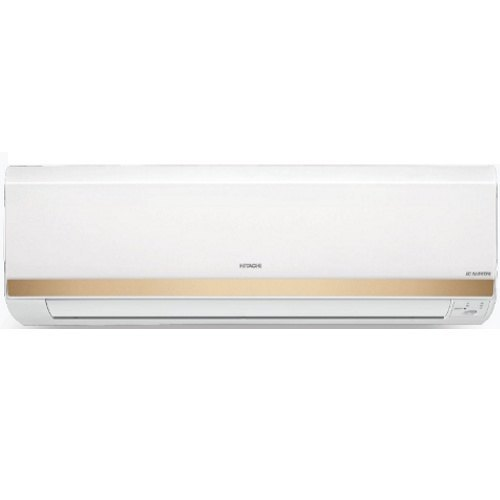

**Video:** https://www.youtube.com/watch?v=hngpuQiMiiY

**Price:** `[PLACEHOLDER]` (price on request)

| Specification | Value |
|---|---|
| Brand | Hitachi |
| Model Number | 3300S |
| Compressor | Rotary |
| Tonnage Class | Available in 1.0TR,1.5TR,1.8TR |
| Model | RSOG312ICEA (Unit),ESOG312ICEA (IDU),CSOG312ICEA (ODU) |
| Power Supply | 230 V/50 Hz |
| Phase | 1 Phase |

**Hitachi Air**
- Auto Coil Dry
- Big Flow Indicator
- Wave Blade Design
- iClean
**Key Feature**
- Filter Clean Indicator
- Tropical Inverter
- iSense Activity Sensor Technology
Other Feature
- Stabiliser
- Eco Friendly Refrigerant
- Inner Grooved Copper
- 43 Quality Test

Source: https://www.indiamart.com/proddetail/hitachi-merai-3300s-inverter-split-acs-20996391948.html

#### 9.1.2 Hitachi Kashikoi 5300FX Inverter Split ACs

**Images:** [hitachi-kashikoi-5300fx-inverter-split-acs.jpg](images/products/inverter-split-acs/hitachi-kashikoi-5300fx-inverter-split-acs.jpg) · [hitachi-kashikoi-5300fx-inverter-split-acs-2.jpg](images/products/inverter-split-acs/hitachi-kashikoi-5300fx-inverter-split-acs-2.jpg) · [hitachi-kashikoi-5300fx-inverter-split-acs-3.jpg](images/products/inverter-split-acs/hitachi-kashikoi-5300fx-inverter-split-acs-3.jpg) · [hitachi-kashikoi-5300fx-inverter-split-acs-4.jpg](images/products/inverter-split-acs/hitachi-kashikoi-5300fx-inverter-split-acs-4.jpg) · [hitachi-kashikoi-5300fx-inverter-split-acs-5.jpg](images/products/inverter-split-acs/hitachi-kashikoi-5300fx-inverter-split-acs-5.jpg) · [hitachi-kashikoi-5300fx-inverter-split-acs-6.jpg](images/products/inverter-split-acs/hitachi-kashikoi-5300fx-inverter-split-acs-6.jpg) · [hitachi-kashikoi-5300fx-inverter-split-acs-7.jpg](images/products/inverter-split-acs/hitachi-kashikoi-5300fx-inverter-split-acs-7.jpg) · [hitachi-kashikoi-5300fx-inverter-split-acs-8.jpg](images/products/inverter-split-acs/hitachi-kashikoi-5300fx-inverter-split-acs-8.jpg) · [hitachi-kashikoi-5300fx-inverter-split-acs-9.jpg](images/products/inverter-split-acs/hitachi-kashikoi-5300fx-inverter-split-acs-9.jpg) · [hitachi-kashikoi-5300fx-inverter-split-acs-10.jpg](images/products/inverter-split-acs/hitachi-kashikoi-5300fx-inverter-split-acs-10.jpg) · [hitachi-kashikoi-5300fx-inverter-split-acs-11.jpg](images/products/inverter-split-acs/hitachi-kashikoi-5300fx-inverter-split-acs-11.jpg) · [hitachi-kashikoi-5300fx-inverter-split-acs-12.jpg](images/products/inverter-split-acs/hitachi-kashikoi-5300fx-inverter-split-acs-12.jpg) · [hitachi-kashikoi-5300fx-inverter-split-acs-13.jpg](images/products/inverter-split-acs/hitachi-kashikoi-5300fx-inverter-split-acs-13.jpg)

**Video:** https://www.youtube.com/watch?v=hngpuQiMiiY

**Price:** `[PLACEHOLDER]` (price on request)

| Specification | Value |
|---|---|
| Brand | Hitachi |
| Model Number | 5300FX |
| Tonnage Class | Available in 1.2TR,1.5TR,2.0TR |
| Compressor Type | Rotary |
| Phase | 1 Phase |
| Power Supply | 230 V/50 Hz |
| Model | RSNG514ACEA (Unit),ESNG514ACEA (IDU),CSNG514ACEA (ODU) |

**Hitachi Air**
- Auto Coil Dry
- Big Flow Indicator
- Wave Blade Design
**Key Feature**
- Expandable Inverter Air Conditioner
- Auto Sleep Mode
- Tropical Inverter
- Stabiliser Free
**Other Feature**
- Eco Friendly Refrigerant
- Inner Grooved Copper
- 43 Quality Test
- Koukin Filter

Source: https://www.indiamart.com/proddetail/hitachi-kashikoi-5300fx-inverter-split-acs-20996074997.html

#### 9.1.3 Hitachi Merai 4100S Inverter Split ACs

**Images:** [hitachi-merai-4100s-inverter-split-acs.jpg](images/products/inverter-split-acs/hitachi-merai-4100s-inverter-split-acs.jpg)

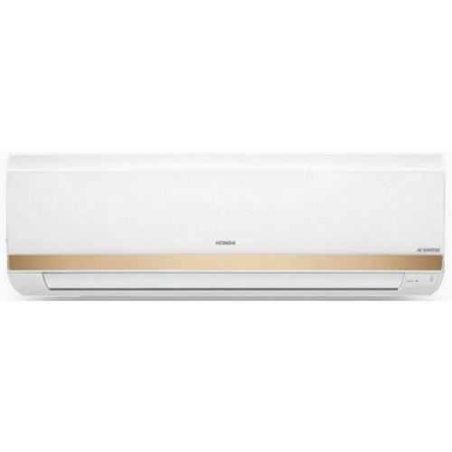

**Price:** `[PLACEHOLDER]` (price on request)

| Specification | Value |
|---|---|
| Brand | Hitachi |
| Compressor Type | Rotary |
| Model Number | 4100S |
| Power Supply | 230 V/50 Hz |
| Model | RSFG412HCEA (Unit),ESFG412HCEA (IDU),CSFG412HCEA (ODU) |
| Tonnage Class | Available in 1.0TR,1.5TR,2.0TR |
| Phase | 1 Phase |

**Hitachi Air**
- Auto Coil Dry
- Big Flow Indicator
- Wave Blade Design
**Key Feature**
- Inner Grooved Copper
- Filter Clean Indicator
- Tropical Inverter
- Stabiliser Free
**Other Feature**
- Eco Friendly Refrigerant
- 43 Quality Test
- Koukin Filter

Source: https://www.indiamart.com/proddetail/hitachi-merai-4100s-inverter-split-acs-20996430591.html

#### 9.1.4 Hitachi Sugoi 4100S Inverter Split ACs

**Images:** [hitachi-sugoi-4100s-inverter-split-acs.jpg](images/products/inverter-split-acs/hitachi-sugoi-4100s-inverter-split-acs.jpg)

**Price:** `[PLACEHOLDER]` (price on request)

| Specification | Value |
|---|---|
| Brand | Hitachi |
| Model Number | 4100S |
| Compressor | Rotary |
| Model | RSG412HCEA (Unit),ESG412HCEA (IDU),CSG412HCEA (ODU) |
| Tonnage Class | Available in 1.0TR,1.5TR,2.0TR |
| Power Supply | 230 V/50 Hz |
| Phase | 1 Phase |

**Hitachi Air**
- Auto Coil Dry
- Big Flow Indicator
- Wave Blade Design
**Key Feature**
- Inner Grooved Copper
- Filter Clean Indicator
- Tropical Inverter
- Stabiliser Free
**Other Feature**
- Eco Friendly Refrigerant
- 43 Quality Test
- Koukin Filter

Source: https://www.indiamart.com/proddetail/hitachi-sugoi-4100s-inverter-split-acs-20996480162.html

#### 9.1.5 Hitachi Kashikoi 5100X Inverter Split ACs

**Images:** [hitachi-kashikoi-5100x-inverter-split-acs.jpg](images/products/inverter-split-acs/hitachi-kashikoi-5100x-inverter-split-acs.jpg)

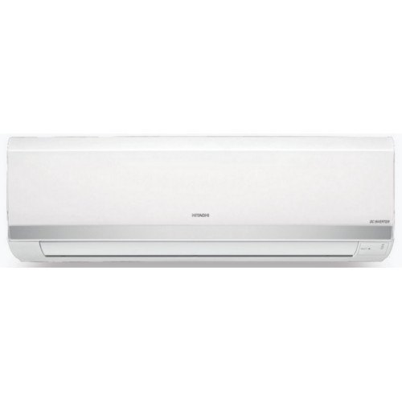

**Price:** `[PLACEHOLDER]` (price on request)

| Specification | Value |
|---|---|
| Model Number | 5100X |
| Brand | Hitachi |
| Compressor Type | Rotary |
| Tonnage Class | Available in 1.0TR,1.2TR,1.5TR,1.6TR,2.0TR,2.1TR |
| Power Supply | 230 V/50 Hz |
| Model | RSFS512HCEA (Unit),ESFS512HCEA (IDU),CSFS512HCEA (ODU) |
| Phase | 1 Phase |

**Hitachi Air**
- Auto Coil Dry
- Big Flow Indicator
- Wave Blade Design
**Key Feature**
- Expandable Inverter Air Conditioner
- Auto Sleep Mode
- Tropical Inverter
- Stabiliser Free
Other Feature
- Eco Friendly Refrigerant
- Inner Grooved Copper
- 43 Quality Test
- Koukin Filter

Source: https://www.indiamart.com/proddetail/hitachi-kashikoi-5100x-inverter-split-acs-20995944897.html

#### 9.1.6 Hitachi Kashikoi 5100X Plus Inverter Split ACs

**Images:** [hitachi-kashikoi-5100x-plus-inverter-split-acs.jpg](images/products/inverter-split-acs/hitachi-kashikoi-5100x-plus-inverter-split-acs.jpg)

**Price:** `[PLACEHOLDER]` (price on request)

| Specification | Value |
|---|---|
| Model Number | 5100X+ |
| Brand | Hitachi |
| Compressor Type | Rotary |
| Power Supply | 230 V/50 Hz |
| Tonnage Class | Available in 1.0TR,1.5TR |
| Model | RSNS512HCEAP (Unit),ESNS512HCEAP (IDU),CSNS512HCEAP (ODU) |
| Phase | 1 Phase |

**Hitachi Air**
- Auto Coil Dry
- Big Flow Indicator
- Wave Blade Design
**Key Feature**
- Expandable Inverter Air Conditioner
- Auto Sleep Mode
- Tropical Inverter
- Stabiliser Free
**Other Feature**
- Eco Friendly Refrigerant
- Inner Grooved Copper
- 43 Quality Test
- Koukin Filter

Source: https://www.indiamart.com/proddetail/hitachi-kashikoi-5100x-plus-inverter-split-acs-20995945697.html

#### 9.1.7 Hitachi Kashikoi 5100X Plus Plus Inverter Split ACs

**Images:** [hitachi-kashikoi-5100x-plus-plus-inverter-split-acs.jpg](images/products/inverter-split-acs/hitachi-kashikoi-5100x-plus-plus-inverter-split-acs.jpg)

**Price:** `[PLACEHOLDER]` (price on request)

| Specification | Value |
|---|---|
| Model Number | 5100X++ |
| Brand | Hitachi |
| Compressor Type | Rotary |
| Power Supply | 230 V/50 Hz |
| Tonnage Class | 1.0TR |
| Model | RSOS512HCEAP (Unit),ESOS512HCEAP (IDU),CSOS512HCEAP (ODU) |
| Phase | 1 Phase |

**Hitachi Air**
- Auto Coil Dry
- Big Flow Indicator
- Wave Blade Design
**Key Feature**
- Expandable Inverter Air Conditioner
- Auto Sleep Mode
- Tropical Inverter
- Stabiliser Free
**Other Feature**
- Eco Friendly Refrigerant
- Inner Grooved Copper
- 43 Quality Test
- Koukin Filter

Source: https://www.indiamart.com/proddetail/hitachi-kashikoi-5100x-plus-plus-inverter-split-acs-20995946233.html

#### 9.1.8 Hitachi Kashikoi 5200X HP Inverter Split ACs

**Images:** [hitachi-kashikoi-5200x-hp-inverter-split-acs.jpg](images/products/inverter-split-acs/hitachi-kashikoi-5200x-hp-inverter-split-acs.jpg)

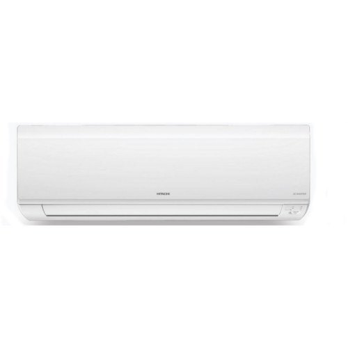

**Price:** `[PLACEHOLDER]` (price on request)

| Specification | Value |
|---|---|
| Model Number | 5200X |
| Brand | Hitachi |
| Compressor Type | Rotary |
| Tonnage Class | Available in 1.0TR,1.5TR,1.8TR |
| Power Supply | 230 V/50 Hz |
| Model | RSB512ABXA (Unit),ESB512ABXA (IDU),CSB512ABXA (ODU) |
| Phase | 1 Phase |

**Hitachi Air**
- Auto Coil Dry
- Big Flow Indicator
- Wave Blade Design
**Key Feature**
- Expandable Inverter Air Conditioner
- Auto Sleep Mode
- Tropical Inverter
- Stabiliser Free
**Other Feature**
- Eco Friendly Refrigerant
- Inner Grooved Copper
- 43 Quality Test
- Koukin Filter

Source: https://www.indiamart.com/proddetail/hitachi-kashikoi-5200x-hp-inverter-split-acs-20996066191.html

#### 9.1.9 Hitachi Kashikoi 5300X Inverter Split ACs

**Images:** [hitachi-kashikoi-5300x-inverter-split-acs.jpg](images/products/inverter-split-acs/hitachi-kashikoi-5300x-inverter-split-acs.jpg)

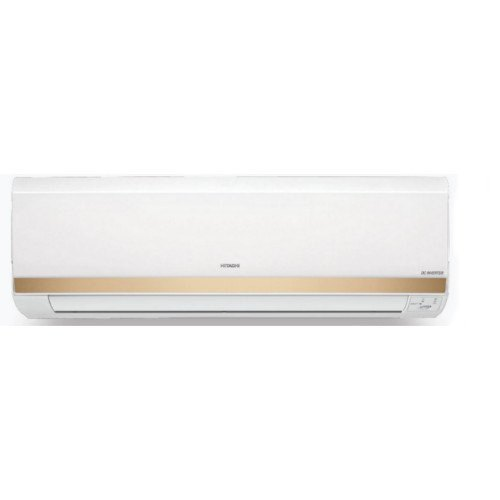

**Price:** `[PLACEHOLDER]` (price on request)

| Specification | Value |
|---|---|
| Model Number | 5300X |
| Brand | Hitachi |
| Compressor Type | Rotary |
| Tonnage Class | Available in 1.0TR,1.5TR,2.0TR |
| Power Supply | 230 V/50 Hz |
| Model | RSNG512ICEA (Unit),ESOG512ICEA (IDU),CSOG512ICEA (ODU) |
| Phase | 1 Phase |

**Hitachi Air**
- Auto Coil Dry
- Big Flow Indicator
- Wave Blade Design
**Key Feature**
- Expandable Inverter Air Conditioner
- Auto Sleep Mode
- Tropical Inverter
- Stabiliser Free
**Other Feature**
- Eco Friendly Refrigerant
- Inner Grooved Copper
- 43 Quality Test
- Koukin Filter

Source: https://www.indiamart.com/proddetail/hitachi-kashikoi-5300x-inverter-split-acs-20996080133.html

#### 9.1.10 Hitachi Kashikoi 5400X Inverter Split ACs

**Images:** [hitachi-kashikoi-5400x-inverter-split-acs.jpg](images/products/inverter-split-acs/hitachi-kashikoi-5400x-inverter-split-acs.jpg)

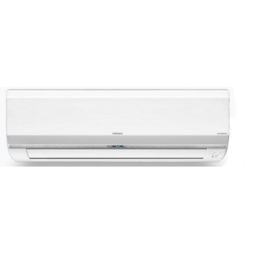

**Price:** `[PLACEHOLDER]` (price on request)

| Specification | Value |
|---|---|
| Model Number | 5400X |
| Brand | Hitachi |
| Compressor Type | Rotary |
| Tonnage Class | Available in 1.0TR,1.5TR,2.0TR |
| Power Supply | 230 V/50 Hz |
| Model | RSA512CBEA (Unit),ESA512CBEA (IDU),CSA512CBEA (ODU) |
| Phase | 1 Phase |

**Hitachi Air**
- Auto Coil Dry
- Big Flow Indicator
- Wave Blade Design
- iClean
**Key Feature**
- Expandable Inverter Air Conditioner
- iSense Activity Sensor Technology
- iSEE Image Sensor Technology
**Other Feature**
- Stainless Steel Filter
- Stabiliser Free
- Eco Friendly Refrigerant
- Inner Grooved Copper

Source: https://www.indiamart.com/proddetail/hitachi-kashikoi-5400x-inverter-split-acs-20996163962.html

#### 9.1.11 Hitachi Takeshi 5100X Inverter Split ACs

**Images:** [hitachi-takeshi-5100x-inverter-split-acs.jpg](images/products/inverter-split-acs/hitachi-takeshi-5100x-inverter-split-acs.jpg)

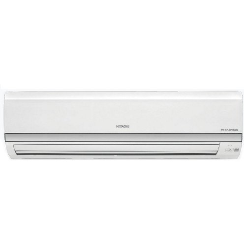

**Price:** `[PLACEHOLDER]` (price on request)

| Specification | Value |
|---|---|
| Brand | Hitachi |
| Model Number | 5100X |
| Tonnage Class | Available in 1.6TR,2.1TR |
| Compressor Type | Rotary |
| Phase | 1 Phase |
| Model | RMZ518HCEA (Unit),EMZ518HCEA (IDU) |
| Power Supply | 230 V/50 Hz |

**Hitachi Air**
- Auto Coil Dry
- Big Flow Deflector
- Wave Blade Design
**Key Feature**
- Expandable Inverter Air Conditioner
- iSense Activity Sensor Technology
- Stainless steel Filter
**Other Feature**
- High Air Flow
- Inner Grooved Copper
- Eco Friendly Refrigerant

Source: https://www.indiamart.com/proddetail/hitachi-takeshi-5100x-inverter-split-acs-20996191797.html

#### 9.1.12 Hitachi Toushi 3100S Inverter Split ACs

**Images:** [hitachi-toushi-3100s-inverter-split-acs.jpg](images/products/inverter-split-acs/hitachi-toushi-3100s-inverter-split-acs.jpg)

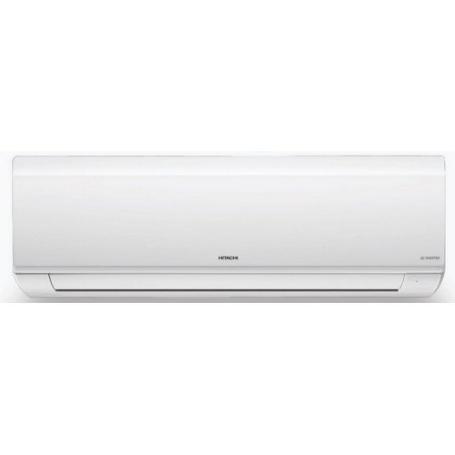

**Price:** `[PLACEHOLDER]` (price on request)

| Specification | Value |
|---|---|
| Model Number | 3100S |
| Brand | Hitachi |
| Compressor Type | Rotary |
| Power Supply | 230 V/50 Hz |
| Model | RSE311HCEAW (Unit),ESE311HCEAW (IDU),CSE311HCEAW (ODU) |
| Tonnage Class | Available in 1.0TR,1.5TR,1.8TR |
| Phase | 1 Phase |

**Hitachi Air**
- Auto Coil Dry
- Big Flow Deflector
- Wave Blade Design
**Key Feature**
- Filter Clean Indicator
- Tropical Inverter
- Stabiliser Free
**Other Feature**
- Eco Friendly Refrigerant
- Inner Grooved Copper
- 43 Quality Tests
- Koukin Filter

Source: https://www.indiamart.com/proddetail/hitachi-toushi-3100s-inverter-split-acs-20996232197.html

#### 9.1.13 Hitachi Toushi 5100X Inverter Split ACs

**Images:** [hitachi-toushi-5100x-inverter-split-acs.jpg](images/products/inverter-split-acs/hitachi-toushi-5100x-inverter-split-acs.jpg)

**Price:** `[PLACEHOLDER]` (price on request)

| Specification | Value |
|---|---|
| Model Number | 5100X |
| Brand | Hitachi |
| Compressor Type | Rotary |
| Power Supply | 230 V/50 Hz |
| Model | RSG512HCEABW (Unit),ESG512HCEABW (IDU),CSG512HCEABW (ODU) |
| Tonnage Class | Available in 1.0TR,1.5TR,2.0TR |
| Phase | 1 Phase |

**Hitachi Air**
- Auto Coil Dry
- Big Flow Deflector
- Wave Blade Design
**Key Feature**
- Stabilizer Free
- Tropical Inverter
- Expendable Inverter Air Conditioner
- Auto Sleep Mode
**Other Feature**
- Filter Clean Indicator
- Eco Friendly Refrigerant
- Inner Grooved Copper
- 43 Quality Test

Source: https://www.indiamart.com/proddetail/hitachi-toushi-5100x-inverter-split-acs-20996278155.html

#### 9.1.14 Hitachi Logicool 3100S Inverter Split ACs

**Images:** [hitachi-logicool-3100s-inverter-split-acs.jpg](images/products/inverter-split-acs/hitachi-logicool-3100s-inverter-split-acs.jpg)

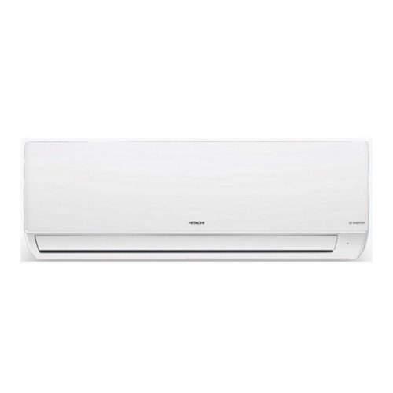

**Price:** `[PLACEHOLDER]` (price on request)

| Specification | Value |
|---|---|
| Model Number | 3100S |
| Brand | Hitachi |
| Compressor Type | Rotary |
| Power Supply | 230 V/50 Hz |
| Model | RSG311HCEABW (Unit),ESG311HCEABW (IDU),CSG311HCEABW (ODU) |
| Phase | 1 Phase |
| Tonnage Class | Available in 1.0TR,1.5TR,1.8TR |

**Hitachi Air**
- Auto Coil Dry
- Big Flow Deflector
- Wave Blade Design
**Key Feature**
- Filter Clean Indicator
- Tropical Inverter
- Stabiliser Free
**Other Feature**
- Inner Grooved Copper
- Eco Friendly Refrigerant
- 43 Quality Test
- Koukin Filter

Source: https://www.indiamart.com/proddetail/hitachi-logicool-3100s-inverter-split-acs-20996697397.html

#### 9.1.15 Hitachi Logicool 4100S Inverter Split ACs

**Images:** [hitachi-logicool-4100s-inverter-split-acs.jpg](images/products/inverter-split-acs/hitachi-logicool-4100s-inverter-split-acs.jpg)

**Price:** `[PLACEHOLDER]` (price on request)

| Specification | Value |
|---|---|
| Model Number | 4100S |
| Brand | Hitachi |
| Compressor Type | Rotary |
| Tonnage Class | Available in 1.0TR,1.5TR,2.0TR |
| Power Supply | 230 V/50 Hz |
| Model | RSG412HCEABW (Unit),ESG412HCEABW (IDU),CSG412HCEABW (ODU) |
| Phase | 1 Phase |

**Hitachi Air**
- Auto Coil Dry
- Big Flow Deflector
- Wave Blade Design
**Key Feature**
- Stabilizer Free
- Filter Clean Indicator
- Tropical Inverter
- Inner Grooved Copper
Other Feature
- Eco Friendly Refrigerant
- 43 Quality Test
- Koukin Filter

Source: https://www.indiamart.com/proddetail/hitachi-logicool-4100s-inverter-split-acs-20996701433.html

#### 9.1.16 Hitachi Logicool 5100X Inverter Split ACs

**Images:** [hitachi-logicool-5100x-inverter-split-acs.jpg](images/products/inverter-split-acs/hitachi-logicool-5100x-inverter-split-acs.jpg)

**Price:** `[PLACEHOLDER]` (price on request)

| Specification | Value |
|---|---|
| Model Number | 5100X |
| Brand | Hitachi |
| Compressor Type | Rotary |
| Tonnage Class | Available in 1.0TR,1.5TR,2.0TR |
| Power Supply | 230 V/50 Hz |
| Model | RSG512HCEABW (Unit),ESG512HCEABW (IDU),CSG512HCEABW (ODU) |
| Phase | 1 Phase |

**Hitachi Air**
- Auto Coil Dry
- Big Flow Indicator
- Wave Blade Design
**Key Feature**
- Expendable Inverter Air Conditioner
- Stabiliser Free
- Tropical Inverter
**Other Feature**
- Filter Clean Indicator
- Eco Friendly Refrigerant
- Inner Grooved Copper
- 43 Quality Test

Source: https://www.indiamart.com/proddetail/hitachi-logicool-5100x-inverter-split-acs-20996711888.html

#### 9.1.17 Hitachi Merai 3100S Inverter Split ACs

**Images:** [hitachi-merai-3100s-inverter-split-acs.jpg](images/products/inverter-split-acs/hitachi-merai-3100s-inverter-split-acs.jpg)

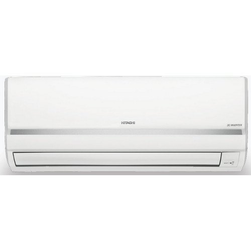

**Price:** `[PLACEHOLDER]` (price on request)

| Specification | Value |
|---|---|
| Model Number | 3100S |
| Brand | Hitachi |
| Compressor Type | Rotary |
| Power Supply | 230 V/50 Hz |
| Model | RSFS311HCEA (Unit),ESFS311HCEA (IDU),CSFS311HCEA (ODU) |
| Tonnage Class | Available in 1.0TR,1.5TR,1.8TR |
| Phase | 1 Phase |

**Hitachi Air**
- Auto Coil Dry
- Big Flow Deflector
- Wave Blade Design
**Key Feature**
- Tropical Inverter
- Filter Clean Indicator
- Stabiliser Free
**Other Feature**
- Eco Friendly Refrigerant
- Inner Copper Grooved
- 43 Qauiity Test
- Koukin Test

Source: https://www.indiamart.com/proddetail/hitachi-merai-3100s-inverter-split-acs-20996327073.html

#### 9.1.18 Hitachi Merai 3100X Inverter Split ACs

**Images:** [hitachi-merai-3100x-inverter-split-acs.jpg](images/products/inverter-split-acs/hitachi-merai-3100x-inverter-split-acs.jpg)

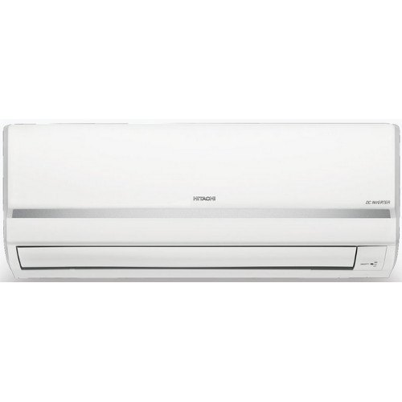

**Price:** `[PLACEHOLDER]` (price on request)

| Specification | Value |
|---|---|
| Model Number | 3100X |
| Brand | Hitachi |
| Compressor Type | Rotary |
| Tonnage Class | Available in 1.0TR,1.2TR,1.5TR,2.0TR |
| Power Supply | 230 V/50 Hz |
| Model | RSFS312HCEA (Unit),ESFS312HCEA (IDU),CSFS312HCEA (ODU) |
| Phase | 1 Phase |

**Hitachi Air**
- Auto Coil Dry
- Big Flow Indicator
- Wave Blade Design
**Key Feature**
- Filter Clean Indicator
- Tropical Inverter
- Expandable Inverter Air Conditioner
**Other Feature**
- Stabiliser Free
- Eco Friendly Refrigerant
- Inner Grooved Copper
- 43 Quality Test

Source: https://www.indiamart.com/proddetail/hitachi-merai-3100x-inverter-split-acs-20996360530.html

#### 9.1.19 Hitachi Sugoi 3100S Inverter Split ACs

**Images:** [hitachi-sugoi-3100s-inverter-split-acs.jpg](images/products/inverter-split-acs/hitachi-sugoi-3100s-inverter-split-acs.jpg)

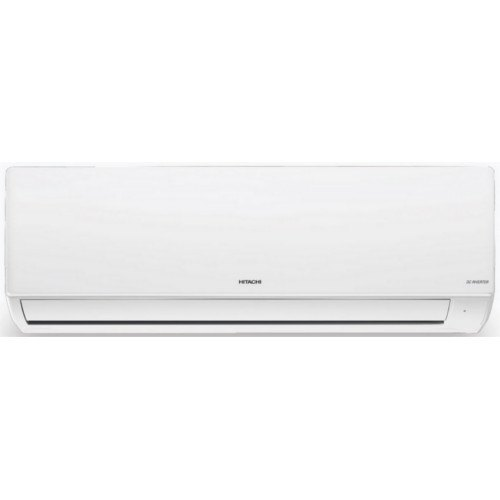

**Price:** `[PLACEHOLDER]` (price on request)

| Specification | Value |
|---|---|
| Model Number | 3100S |
| Brand | Hitachi |
| Compressor Type | Rotary |
| Tonnage Class | Available in 1.0TR,1.5TR,1.8TR |
| Power Supply | 230 V/50 Hz |
| Model | RSG311HCEA (Unit),ESG311HCEA (IDU),CSG311HCEA (ODU) |
| Phase | 1 Phase |

**Hitachi Air**
- Auto Coil Dry
- Big Flow Deflector
- Wave Blade Design
**Key Feature**
- Filter Clean Indicator
- Tropical Inverter
- Stabiliser Free
**Other Feature**
- Eco Friendly Refrigerant
- Inner Grooved Copper
- Koukin Filter
- 43 Quality Test

Source: https://www.indiamart.com/proddetail/hitachi-sugoi-3100s-inverter-split-acs-20996486273.html

#### 9.1.20 Hitachi ACE 3100S Inverter Split ACs

**Images:** [hitachi-ace-3100s-inverter-split-acs.jpg](images/products/inverter-split-acs/hitachi-ace-3100s-inverter-split-acs.jpg)

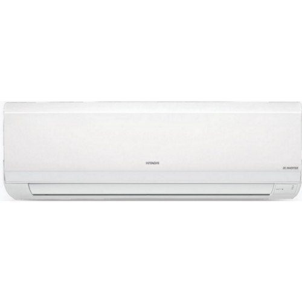

**Price:** `[PLACEHOLDER]` (price on request)

| Specification | Value |
|---|---|
| Model Number | 3100S |
| Brand | Hitachi |
| Compressor Type | Rotary |
| Power Supply | 230 V/50 Hz |
| Tonnage Class | Available in 1.0TR,1.5TR,1.8TR |
| Phase | 1 Phase |

**Hitachi Air**
- Auto Coil Dry
- Big Flow Indicator
- Wave Blade Design
**Key Feature**
- Filter Clean Indicator
- Tropical Inverter
- Stabiliser Free
**Other Feature**
- Eco Friendly Refrigerant
- Inner Grooved Copper
- 43 Quality Test
- Koukin Filter

Source: https://www.indiamart.com/proddetail/hitachi-ace-3100s-inverter-split-acs-20996613633.html

#### 9.1.21 Hitachi ACE 4100S Inverter Split ACs

**Images:** [hitachi-ace-4100s-inverter-split-acs.jpg](images/products/inverter-split-acs/hitachi-ace-4100s-inverter-split-acs.jpg)

**Price:** `[PLACEHOLDER]` (price on request)

| Specification | Value |
|---|---|
| Brand | Hitachi |
| Model Number | 4100S |
| Compressor Type | Rotary |
| Phase | 1 Phase |
| Model | RSF412HCEA (Unit),ESF412HCEA (IDU),CSF412HCEA (ODU) |
| Power Supply | 230 V/50 Hz |
| Tonnage Class | Available in 1.0TR,1.5TR,2.0TR |

**Hitachi Air**
- Auto Coil Dry
- Big Flow Deflector
- Wave Blade Design
**Key Feature **
- Inner Grooved Copper
- Tropical Inverter
- Filter Clean Indicator
**Other Feature**
- Eco Friendly Refrigerant
- Stabiliser Free
- Koukin Filter

Source: https://www.indiamart.com/proddetail/hitachi-ace-4100s-inverter-split-acs-20996619012.html

#### 9.1.22 Hitachi Split Air Conditioners

**Images:** `[PLACEHOLDER IMAGE]`

**Price:** `[PLACEHOLDER]` (price on request)

**Description:** `[PLACEHOLDER]` (no details given on IndiaMART)

### 9.2 Fixed Speed Split ACs (9)

> We are Hitachi's preferred channel partner. We offer Hitachi's full range of fixed speed split ACs that covers TAKESHI, ZUNOH & LOGICOOL series.

#### 9.2.1 Hitachi Zunoh 3100F 1.5TR Fixed Speed Split ACs

**Images:** [hitachi-zunoh-3100f-1-5tr-fixed-speed-split-acs.jpg](images/products/fixed-speed-split-acs/hitachi-zunoh-3100f-1-5tr-fixed-speed-split-acs.jpg)

**Price:** `[PLACEHOLDER]` (price on request)

| Specification | Value |
|---|---|
| Model Number | 3100F |
| Brand | Hitachi |
| Compressor Type | Rotary |
| Tonnage Class | 1.5TR |
| Power Supply | 230 V/50 Hz |
| Model | RSNG318HCDO (Unit),ESNG318HCDO (IDU),CSNG318HCDO (ODU) |
| Phase | 1 Phase |

**Feature-**
- Auto Coil Dry
- Big Flow Deflector
- Filter Clean Indicator

Source: https://www.indiamart.com/proddetail/hitachi-zunoh-3100f-1-5tr-fixed-speed-split-acs-20996818788.html

#### 9.2.2 Hitachi Zunoh 3100F 2.0TR Fixed Speed Split ACs

**Images:** [hitachi-zunoh-3100f-2-0tr-fixed-speed-split-acs.jpg](images/products/fixed-speed-split-acs/hitachi-zunoh-3100f-2-0tr-fixed-speed-split-acs.jpg)

**Price:** `[PLACEHOLDER]` (price on request)

| Specification | Value |
|---|---|
| Model Number | 3100F |
| Brand | Hitachi |
| Compressor Type | Rotary |
| Power Supply | 230 V/50 Hz |
| Model | RMZ324HCDO (Unit),EMZ324HCDO (IDU),CMZ324HCDO (ODU) |
| Phase | 1 Phase |

**Feature-**
- Auto Coil Dry
- Big Flow Deflector
- Filter Clean Indicator

Source: https://www.indiamart.com/proddetail/hitachi-zunoh-3100f-2-0tr-fixed-speed-split-acs-20996818612.html

#### 9.2.3 Hitachi Logicool 3100F 1.5TR Fixed Speed Split ACs

**Images:** [hitachi-logicool-3100f-1-5tr-fixed-speed-split-acs.jpg](images/products/fixed-speed-split-acs/hitachi-logicool-3100f-1-5tr-fixed-speed-split-acs.jpg)

**Price:** `[PLACEHOLDER]` (price on request)

| Specification | Value |
|---|---|
| Model Number | RSD318HCDOBW (Unit),ESD318HCDOBW (IDU),CSD318HCDOBW (ODU) |
| Brand | Hitachi |
| Compressor Type | Rotary |
| Tonnage Class | 1.5TR |
| Power Supply | 230 V/50 Hz |
| Model | 3100F |
| Phase | 1 Phase |

**Feature-**
- Auto Coil Dry
- Big Flow Deflector
- Filter Clean Indicator

Source: https://www.indiamart.com/proddetail/hitachi-logicool-3100f-1-5tr-fixed-speed-split-acs-20996857862.html

#### 9.2.4 Hitachi Zunoh 3100F 1.8TR Fixed Speed Split ACs

**Images:** [hitachi-zunoh-3100f-1-8tr-fixed-speed-split-acs.jpg](images/products/fixed-speed-split-acs/hitachi-zunoh-3100f-1-8tr-fixed-speed-split-acs.jpg)

**Price:** `[PLACEHOLDER]` (price on request)

| Specification | Value |
|---|---|
| Model Number | 3100F |
| Brand | Hitachi |
| Compressor Type | Rotary |
| Power Supply | 230 V/50 Hz |
| Phase | 1 Phase |
| Model | RMO322HCDO (Unit),EMO322HCDO (IDU),CMO322HCDO (ODU) |

**Feature-**
- Auto Coil Dry
- Big Flow Deflector
- Filter Clean Indicator

Source: https://www.indiamart.com/proddetail/hitachi-zunoh-3100f-1-8tr-fixed-speed-split-acs-20996912248.html

#### 9.2.5 Hitachi Logicool 3100F 1.8TR Fixed Speed Split ACs

**Images:** [hitachi-logicool-3100f-1-8tr-fixed-speed-split-acs.jpg](images/products/fixed-speed-split-acs/hitachi-logicool-3100f-1-8tr-fixed-speed-split-acs.jpg)

**Price:** `[PLACEHOLDER]` (price on request)

| Specification | Value |
|---|---|
| Model Number | RMC322HCDOBW (Unit),EMC322HCDOBW (IDU),CMC322HCDOBW (ODU) |
| Brand | Hitachi |
| Compressor Type | Rotary |
| Tonnage Class | 1.8TR |
| Power Supply | 230 V/50 Hz |
| Phase | 1 Phase |
| Model | 3100F |

**Feature-**
- Auto Coil Dry
- Big Flow Deflector
- Filter Clean Indicator

Source: https://www.indiamart.com/proddetail/hitachi-logicool-3100f-1-8tr-fixed-speed-split-acs-20996905030.html

#### 9.2.6 Hitachi Logicool 3100F 2.0TR Fixed Speed Split ACs

**Images:** [hitachi-logicool-3100f-2-0tr-fixed-speed-split-acs.jpg](images/products/fixed-speed-split-acs/hitachi-logicool-3100f-2-0tr-fixed-speed-split-acs.jpg)

**Price:** `[PLACEHOLDER]` (price on request)

| Specification | Value |
|---|---|
| Model Number | RMZ324HCDOBW (Unit),EMZ324HCDOBW (IDU),CMZ324HCDOBW (ODU) |
| Brand | Hitachi |
| Compressor Type | Rotary |
| Tonnage Class | 2.0TR |
| Power Supply | 230 V/50 Hz |
| Phase | 1 Phase |
| Model | 3100F |

**Feature-**
- Auto Coil Dry
- Big Flow Deflector
- Filter Clean Indicator

Source: https://www.indiamart.com/proddetail/hitachi-logicool-3100f-2-0tr-fixed-speed-split-acs-20996901948.html

#### 9.2.7 Hitachi Zunoh 3100F 1.0TR Fixed Speed Split ACs

**Images:** [hitachi-zunoh-3100f-1-0tr-fixed-speed-split-acs.jpg](images/products/fixed-speed-split-acs/hitachi-zunoh-3100f-1-0tr-fixed-speed-split-acs.jpg)

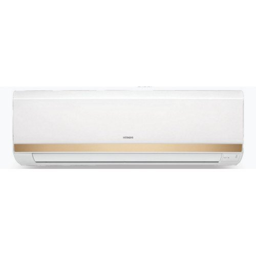

**Price:** `[PLACEHOLDER]` (price on request)

| Specification | Value |
|---|---|
| Model Number | 3100F |
| Brand | Hitachi |
| Compressor Type | Rotary |
| Tonnage Class | 1.0TR |
| Power Supply | 230 V/50 Hz |
| Model | RSFG312HCDO |
| Phase | 1 Phase |

**Feature-**
- Auto Coil Dry
- Big Flow Deflector
- Filter Clean Indicator

Source: https://www.indiamart.com/proddetail/hitachi-zunoh-3100f-1-0tr-fixed-speed-split-acs-20996964462.html

#### 9.2.8 Hitachi Logicool 3100F 1.0TR Fixed Speed Split ACs

**Images:** [hitachi-logicool-3100f-1-0tr-fixed-speed-split-acs.jpg](images/products/fixed-speed-split-acs/hitachi-logicool-3100f-1-0tr-fixed-speed-split-acs.jpg)

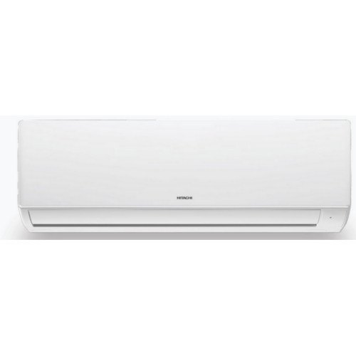

**Price:** `[PLACEHOLDER]` (price on request)

| Specification | Value |
|---|---|
| Model Number | RSG312HCDOBW (Unit),ESG312HCDOBW (IDU),CSG312HCDOBW (ODU) |
| Brand | Hitachi |
| Compressor Type | Rotary |
| Tonnage Class | 1.0TR |
| Power Supply | 230 V/50 Hz |
| Model | 3100F |
| Phase | 1 Phase |

**Feature-**
- Auto Coil Dry
- Big Flow Deflector
- Filter Clean Indicator

Source: https://www.indiamart.com/proddetail/hitachi-logicool-3100f-1-0tr-fixed-speed-split-acs-20996970197.html

#### 9.2.9 Hitachi Takeshi 3100F 2.5TR Fixed Speed Split ACs

**Images:** [hitachi-takeshi-3100f-2-5tr-fixed-speed-split-acs.jpg](images/products/fixed-speed-split-acs/hitachi-takeshi-3100f-2-5tr-fixed-speed-split-acs.jpg)

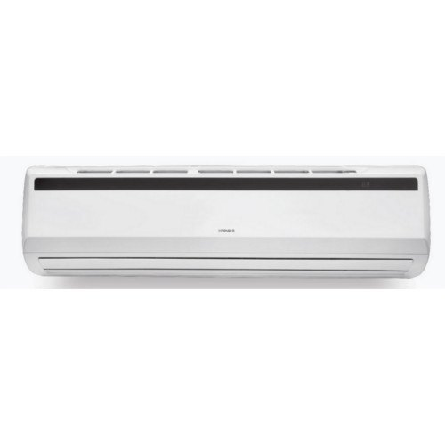

**Price:** `[PLACEHOLDER]` (price on request)

| Specification | Value |
|---|---|
| Model Number | 3100F |
| Brand | Hitachi |
| Compressor Type | Rotary |
| Tonnage Class | 2.5TR |
| Power Supply | 230 V/50 Hz |
| Model | RBZ230HCDAW (Unit),EBZ230HCDAW (IDU),CBZ230HCDAW (ODU) |
| Phase | 1 Phase |

**Feature-**
- Auto Coil Dry
- Big Flow Deflector
- Filter Clean Indicator

Source: https://www.indiamart.com/proddetail/hitachi-takeshi-3100f-2-5tr-fixed-speed-split-acs-20996969648.html

### 9.3 Window ACs (11)

> We are Hitachi's preferred channel partner and offer you a complete range of window ACs from SUMMER TM, SUMMER QC, KAZE REIDAN, KAZE PLUS and KAZE PLUS ECO series.

#### 9.3.1 Hitachi SUMMER QC 1.5TR Window ACs

**Images:** [hitachi-summer-qc-1-5tr-window-acs.jpg](images/products/window-acs/hitachi-summer-qc-1-5tr-window-acs.jpg)

**Price:** `[PLACEHOLDER]` (price on request)

| Specification | Value |
|---|---|
| Star Rating | 5 Star |
| Brand | Hitachi |
| Compressor Type | Rotary |
| Model Number | RAV518HUD (Unit) |
| Tonnage Class | 1.5TR |
| Power Supply | 230 V/50 Hz |
| Phase | 1 Phase |

Feature-
- Innovative Feature
- Powerful Mode
- Filter Clean Indicator

Source: https://www.indiamart.com/proddetail/hitachi-summer-qc-1-5tr-window-acs-20997034033.html

#### 9.3.2 Hitachi KAZE PLUS RAW511KUD Window ACs

**Images:** [hitachi-kaze-plus-raw511kud-window-acs.jpg](images/products/window-acs/hitachi-kaze-plus-raw511kud-window-acs.jpg)

**Price:** `[PLACEHOLDER]` (price on request)

| Specification | Value |
|---|---|
| Star Rating | 5 Star |
| Brand | Hitachi |
| Compressor Type | Rotary |
| Model Number | RAW511KUD |
| Tonnage Class | 1.0 TR |
| Power Supply | 230 V/50 Hz |
| Phase | Phase |

Feature-
- Innovative Feature
- Powerful Mode
- Filter Clean Indicator

Source: https://www.indiamart.com/proddetail/hitachi-kaze-plus-raw511kud-window-acs-20997139497.html

#### 9.3.3 Hitachi KAZE PLUS RAW312KWD Window ACs

**Images:** [hitachi-kaze-plus-raw312kwd-window-acs.jpg](images/products/window-acs/hitachi-kaze-plus-raw312kwd-window-acs.jpg)

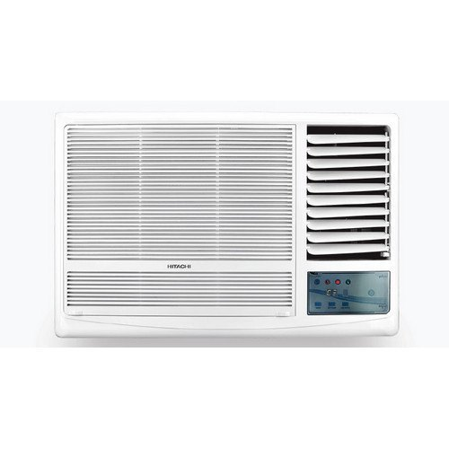

**Price:** `[PLACEHOLDER]` (price on request)

| Specification | Value |
|---|---|
| Star Rating | 3 Star |
| Brand | Hitachi |
| Compressor Type | Rotary |
| Model Number | RAW312KWD |
| Tonnage Class | 1.0TR |
| Power Supply | 230 V/50 Hz |
| Phase | 1 Phase |

Feature-
- Innovative Feature
- Powerful Mode
- Filter Clean Indicator

Source: https://www.indiamart.com/proddetail/hitachi-kaze-plus-raw312kwd-window-acs-20997133333.html

#### 9.3.4 Hitachi KAZE PLUS RAW518KUDZ1 Window ACs

**Images:** [hitachi-kaze-plus-raw518kudz1-window-acs.jpg](images/products/window-acs/hitachi-kaze-plus-raw518kudz1-window-acs.jpg)

**Price:** `[PLACEHOLDER]` (price on request)

| Specification | Value |
|---|---|
| Star Rating | 5 Star |
| Brand | Hitachi |
| Compressor Type | Rotary |
| Model Number | RAW518KUDZ1 |
| Power Supply | 230 V/50 Hz |
| Tonnage Class | 1.5TR |
| Phase | 1 Phase |

Feature-
- Innovative Feature
- Powerful Mode
- Filter Clean Indicator

Source: https://www.indiamart.com/proddetail/hitachi-kaze-plus-raw518kudz1-window-acs-20997133562.html

#### 9.3.5 Hitachi KAZE PLUS RAW318KUD Window ACs

**Images:** [hitachi-kaze-plus-raw318kud-window-acs.jpg](images/products/window-acs/hitachi-kaze-plus-raw318kud-window-acs.jpg)

**Price:** `[PLACEHOLDER]` (price on request)

| Specification | Value |
|---|---|
| Star Rating | 3 Star |
| Brand | Hitachi |
| Compressor Type | Rotary |
| Model Number | RAW318KUD |
| Tonnage Class | 1.5TR |
| Power Supply | 230 V/50 Hz |
| Phase | 1 Phase |

Feature-
- Innovative Feature
- Powerful Mode
- Filter Clean Indicator

Source: https://www.indiamart.com/proddetail/hitachi-kaze-plus-raw318kud-window-acs-20997134862.html

#### 9.3.6 Hitachi KAZE PLUS RAW218KUD Window ACs

**Images:** [hitachi-kaze-plus-raw218kud-window-acs.jpg](images/products/window-acs/hitachi-kaze-plus-raw218kud-window-acs.jpg)

**Price:** `[PLACEHOLDER]` (price on request)

| Specification | Value |
|---|---|
| Star Rating | 3 Star |
| Brand | Hitachi |
| Compressor Type | Rotary |
| Model Number | RAW218KUD |
| Tonnage Class | 1.5TR |
| Power Supply | 230 V/50 Hz |
| Phase | 1 Phase |

Feature-
- Innovative Feature
- Powerful Mode
- Filter Clean Indicator

Source: https://www.indiamart.com/proddetail/hitachi-kaze-plus-raw218kud-window-acs-20997135548.html

#### 9.3.7 Hitachi KAZE PLUS RAW222KUD Window ACs

**Images:** [hitachi-kaze-plus-raw222kud-window-acs.jpg](images/products/window-acs/hitachi-kaze-plus-raw222kud-window-acs.jpg)

**Price:** `[PLACEHOLDER]` (price on request)

| Specification | Value |
|---|---|
| Star Rating | 2 Star |
| Brand | Hitachi |
| Compressor Type | Rotary |
| Model Number | RAW222KUD |
| Power Supply | 230 V/50 Hz |
| Tonnage Class | 2.0 TR |
| Phase | 1 Phase |

Feature-
- Innovative Feature
- Powerful Mode
- Filter Clean Indicator

Source: https://www.indiamart.com/proddetail/hitachi-kaze-plus-raw222kud-window-acs-20997136791.html

#### 9.3.8 Hitachi KAZE REIDAN 1.5TR Window ACs

**Images:** [hitachi-kaze-reidan-1-5tr-window-acs.jpg](images/products/window-acs/hitachi-kaze-reidan-1-5tr-window-acs.jpg)

**Price:** `[PLACEHOLDER]` (price on request)

| Specification | Value |
|---|---|
| Star Rating | 2 Star |
| Brand | Hitachi |
| Compressor Type | Rotary |
| Model Number | RAW218KYH (Unit) |
| Tonnage Class | 1.5 TR |
| Power Supply | 230 V/50 Hz |
| Phase | 1 Phase |

Feature-
- Innovative Feature
- Powerful Mode
- Filter Clean Indicator

Source: https://www.indiamart.com/proddetail/hitachi-kaze-reidan-1-5tr-window-acs-20997137433.html

#### 9.3.9 Hitachi SUMMER TM Window AC

**Images:** [hitachi-summer-tm-window-ac.jpg](images/products/window-acs/hitachi-summer-tm-window-ac.jpg)

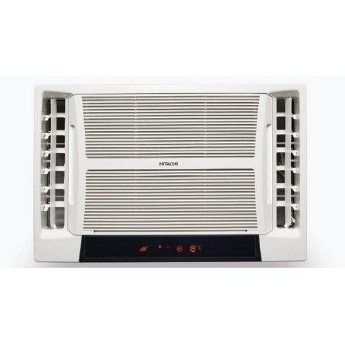

**Price:** `[PLACEHOLDER]` (price on request)

| Specification | Value |
|---|---|
| Star Rating | 5 Star |
| Brand | Hitachi |
| Compressor Type | Rotary |
| Model Number | RAT518HUD |
| Tonnage Class | 1.5TR |
| Power Supply | 230 V/50 Hz |
| Phase | 1 Phase |

Feature-
- Twin Air Flow
- Silent Cooling

Source: https://www.indiamart.com/proddetail/hitachi-summer-tm-window-ac-20997048433.html

#### 9.3.10 Hitachi SUMMER QC 1.1TR Window ACs

**Images:** [hitachi-summer-qc-1-1tr-window-acs.jpg](images/products/window-acs/hitachi-summer-qc-1-1tr-window-acs.jpg)

**Price:** `[PLACEHOLDER]` (price on request)

| Specification | Value |
|---|---|
| Star Rating | 5 Star |
| Brand | Hitachi |
| Compressor Type | Rotary |
| Model Number | RAV513HUD (Unit) |
| Tonnage Class | 1.1TR |
| Power Supply | 230 V/50 Hz |
| Phase | 1 Phase |

Feature-
- Twin Air Flow
- Silent Cooling

Source: https://www.indiamart.com/proddetail/hitachi-summer-qc-1-1tr-window-acs-20997047233.html

#### 9.3.11 Hitachi Window Air Conditioner

**Images:** `[PLACEHOLDER IMAGE]`

**Price:** `[PLACEHOLDER]` (price on request)

**Description:** `[PLACEHOLDER]` (no details given on IndiaMART)

### 9.4 Light Commercial Air Conditioners (14)

> We are Hitachi's preferred channel partner and offer you complete solution with our wide range of Cassette Air Conditioners and Concealed Split Air Conditioners.

#### 9.4.1 Hitachi Flexi Split Air Conditioner

**Images:** [hitachi-flexi-split-air-conditioner.jpg](images/products/light-commercial-air-conditioners/hitachi-flexi-split-air-conditioner.jpg) · [hitachi-flexi-split-air-conditioner-2.jpg](images/products/light-commercial-air-conditioners/hitachi-flexi-split-air-conditioner-2.jpg) · [hitachi-flexi-split-air-conditioner-3.jpg](images/products/light-commercial-air-conditioners/hitachi-flexi-split-air-conditioner-3.jpg) · [hitachi-flexi-split-air-conditioner-4.jpg](images/products/light-commercial-air-conditioners/hitachi-flexi-split-air-conditioner-4.jpg) · [hitachi-flexi-split-air-conditioner-5.jpg](images/products/light-commercial-air-conditioners/hitachi-flexi-split-air-conditioner-5.jpg) · [hitachi-flexi-split-air-conditioner-6.jpg](images/products/light-commercial-air-conditioners/hitachi-flexi-split-air-conditioner-6.jpg) · [hitachi-flexi-split-air-conditioner-7.jpg](images/products/light-commercial-air-conditioners/hitachi-flexi-split-air-conditioner-7.jpg) · [hitachi-flexi-split-air-conditioner-8.jpg](images/products/light-commercial-air-conditioners/hitachi-flexi-split-air-conditioner-8.jpg) · [hitachi-flexi-split-air-conditioner-9.jpg](images/products/light-commercial-air-conditioners/hitachi-flexi-split-air-conditioner-9.jpg)

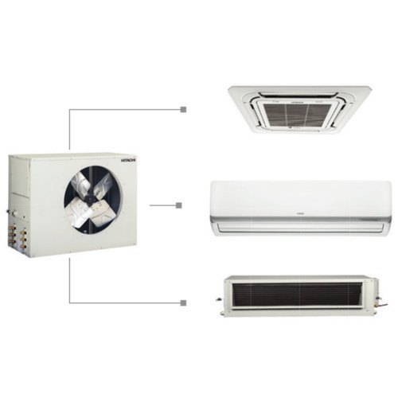

**Price:** `[PLACEHOLDER]` (price on request)

| Specification | Value |
|---|---|
| Brand | Hitachi |
| ODU Power | 3 TR,4 TR,5 TR,7.5 TR |
| Cassette Power | 1.5 TR,2 TR,2.5 TR |
| Hi Wall Power | 1.5 TR,2 TR,2.5 TR |
| In the Ceiling Power | 1.5 TR,2 TR,2.5 TR |
| Choices of IDU | Any of 2,Any of 3 |
| IDU Units | Cassette,Hi Wall,In the Ceiling |

**Features:**
- Customise selection available with IDU options
- Individual wireless remote for all IDU
- Inbuilt redundancy
- Lower installation cost

Source: https://www.indiamart.com/proddetail/hitachi-flexi-split-air-conditioner-20995126055.html

#### 9.4.2 Hitachi R410a Inverter Series Cassette Air Conditioner

**Images:** [hitachi-r410a-inverter-series-cassette-air-conditioner.jpg](images/products/light-commercial-air-conditioners/hitachi-r410a-inverter-series-cassette-air-conditioner.jpg)

**Price:** `[PLACEHOLDER]` (price on request)

| Specification | Value |
|---|---|
| Brand | Hitachi |
| Compressor Type | Rotary |
| Rated Power Supply | 230 V / 50 Hz |
| Tonnage Class | 1.5 TR,2 TR |
| Refrigerant | R410A |
| Phase | 1 phase |

**Advance Features:**
- Fresh air intake
- Sleep and timer control
- Dimensional screw fan
Key Features:
- On/off timer with Advance start-up
- 43 quality tests
- Dry mode
Other Features:
- Inner grooved copper
- Tropical design

Source: https://www.indiamart.com/proddetail/hitachi-r410a-inverter-series-cassette-air-conditioner-20995078533.html

#### 9.4.3 Hitachi R410a Fixed Speed Series Cassette Air Conditioner

**Images:** [hitachi-r410a-fixed-speed-series-cassette-air-conditioner.jpg](images/products/light-commercial-air-conditioners/hitachi-r410a-fixed-speed-series-cassette-air-conditioner.jpg)

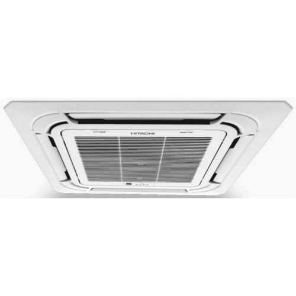

**Price:** `[PLACEHOLDER]` (price on request)

| Specification | Value |
|---|---|
| Brand | Hitachi |
| Compressor Type | Rotary |
| Tonnage Class | 1.5 TR to 4 TR |
| Refrigerant | R410A |
| Rated Power Supply | 230 V/50 Hz |
| Phase | 1 phase |

**Advance Features:**
- Fresh air intake
- Sleep and timer control
- Dimensional screw fan
- Eco-friendly refrigerant
Key Features:
- On/off timer with Advance start-up
- 43 quality tests
- Dry mode
Other Features:
- Inner grooved copper
- Tropical design

Source: https://www.indiamart.com/proddetail/hitachi-r410a-fixed-speed-series-cassette-air-conditioner-20995097288.html

#### 9.4.4 Hitachi R22 Fixed Speed Series Cassette Air Conditioner

**Images:** [hitachi-r22-fixed-speed-series-cassette-air-conditioner.jpg](images/products/light-commercial-air-conditioners/hitachi-r22-fixed-speed-series-cassette-air-conditioner.jpg)

**Price:** `[PLACEHOLDER]` (price on request)

| Specification | Value |
|---|---|
| Brand | Hitachi |
| Star Rating | 3 Star |
| Compressor Type | Rotary / Twin Rotary |
| Refrigerant | R22 |
| Phase | 1 phase |
| Tonnage Class | 1.5 TR to 4 TR |
| Rated Power Supply | 230 V / 50 Hz |

Advance Features:
- Fresh air intake
- Sleep and timer control
- Dimensional screw fan
Key Features:
- On/off timer with Advance start-up
- 43 quality tests
- Dry mode
Other Features:
- Inner grooved copper
- Tropical design

Source: https://www.indiamart.com/proddetail/hitachi-r22-fixed-speed-series-cassette-air-conditioner-20995112655.html

#### 9.4.5 Hitachi 1.5 TR R410a Concealed Split Air Conditioner

**Images:** [hitachi-1-5-tr-r410a-concealed-split-air-conditioner.jpg](images/products/light-commercial-air-conditioners/hitachi-1-5-tr-r410a-concealed-split-air-conditioner.jpg)

**Price:** `[PLACEHOLDER]` (price on request)

| Specification | Value |
|---|---|
| Model Number | 1.5 TR |
| Brand | Hitachi |
| Compressor Type | Rotary |
| Refrigerant | R410a |
| Rated Power Supply | 230 V,50 Hz (IDU / ODU) |
| Phase | 1 phase |

**Features:**
- Wireless remote/wired remote
- Can work in temperature up to 52 deg C
- Kaimin mode
- Auto restart
- 5 modes of operation
- Filter clean indicator
- On/off timer with advanced startup

Source: https://www.indiamart.com/proddetail/hitachi-1-5-tr-r410a-concealed-split-air-conditioner-20995164297.html

#### 9.4.6 Hitachi 2.0 TR R410a Concealed Split Air Conditioner

**Images:** [hitachi-2-0-tr-r410a-concealed-split-air-conditioner.jpg](images/products/light-commercial-air-conditioners/hitachi-2-0-tr-r410a-concealed-split-air-conditioner.jpg)

**Price:** `[PLACEHOLDER]` (price on request)

| Specification | Value |
|---|---|
| Model Number | 2.0 TR |
| Brand | Hitachi |
| Compressor Type | Rotary |
| Refrigerant | R410a |
| Rated Power Supply | 230 V,50 Hz (IDU / ODU) |
| Phase | 1 phase |

**Features:**
- Wireless remote/wired remote
- Can work in temperature up to 52 deg C
- Kaimin mode
- Auto restart
- 5 modes of operation
- Filter clean indicator
- On/off timer with advanced startup

Source: https://www.indiamart.com/proddetail/hitachi-2-0-tr-r410a-concealed-split-air-conditioner-20995165812.html

#### 9.4.7 Hitachi 3.0 TR R410a Concealed Split Air Conditioner

**Images:** [hitachi-3-0-tr-r410a-concealed-split-air-conditioner.jpg](images/products/light-commercial-air-conditioners/hitachi-3-0-tr-r410a-concealed-split-air-conditioner.jpg)

**Price:** `[PLACEHOLDER]` (price on request)

| Specification | Value |
|---|---|
| Model Number | 3.0 TR |
| Brand | Hitachi |
| Compressor Type | Rotary |
| Refrigerant | R410a |
| Rated Power Supply | 230 V,50 Hz (IDU / ODU) |
| Phase | 1 phase |

**Features:**
- Wireless remote/wired remote
- Can work in temperature up to 52 deg C
- Kaimin mode
- Auto restart
- 5 modes of operation
- Filter clean indicator
- On/off timer with advanced startup

Source: https://www.indiamart.com/proddetail/hitachi-3-0-tr-r410a-concealed-split-air-conditioner-20995166762.html

#### 9.4.8 Hitachi 4.0 TR R410a Concealed Split Air Conditioner

**Images:** [hitachi-4-0-tr-r410a-concealed-split-air-conditioner.jpg](images/products/light-commercial-air-conditioners/hitachi-4-0-tr-r410a-concealed-split-air-conditioner.jpg)

**Price:** `[PLACEHOLDER]` (price on request)

| Specification | Value |
|---|---|
| Model Number | 4.0 TR |
| Brand | Hitachi |
| Compressor Type | Rotary |
| Refrigerant | R410a |
| Rated Power Supply | 230 V,50 Hz (IDU / ODU) |
| Phase | 1 phase |

**Features:**
- Wireless remote/wired remote
- Can work in temperature up to 52 deg C
- Kaimin mode
- Auto restart
- 5 modes of operation
- Filter clean indicator
- On/off timer with advanced startup

Source: https://www.indiamart.com/proddetail/hitachi-4-0-tr-r410a-concealed-split-air-conditioner-20995167355.html

#### 9.4.9 Hitachi 1.5 TR R22 Concealed Split Air Conditioner

**Images:** [hitachi-1-5-tr-r22-concealed-split-air-conditioner.jpg](images/products/light-commercial-air-conditioners/hitachi-1-5-tr-r22-concealed-split-air-conditioner.jpg)

**Price:** `[PLACEHOLDER]` (price on request)

| Specification | Value |
|---|---|
| Model Number | 1.5 TR |
| Brand | Hitachi |
| Compressor Type | Rotary |
| Refrigerant | R22 |
| Rated Power Supply | 230 V,50 Hz (IDU / ODU) |
| Phase | 1 phase |

**Features:**
- Wireless remote/wired remote
- Can work in temperature up to 52 deg C
- Kaimin mode
- Auto restart
- 5 modes of operation
- Filter clean indicator
- On/off timer with advanced startup

Source: https://www.indiamart.com/proddetail/hitachi-1-5-tr-r22-concealed-split-air-conditioner-20995251812.html

#### 9.4.10 Hitachi 2.0 TR R22 Concealed Split Air Conditioner

**Images:** [hitachi-2-0-tr-r22-concealed-split-air-conditioner.jpg](images/products/light-commercial-air-conditioners/hitachi-2-0-tr-r22-concealed-split-air-conditioner.jpg)

**Price:** `[PLACEHOLDER]` (price on request)

| Specification | Value |
|---|---|
| Model Number | 2.0 TR |
| Brand | Hitachi |
| Compressor Type | Rotary |
| Refrigerant | R22 |
| Rated Power Supply | 230 V,50 Hz (IDU / ODU) |
| Phase | 1 phase |

**Features:**
- Wireless remote/wired remote
- Can work in temperature up to 52 deg C
- Kaimin mode
- Auto restart
- 5 modes of operation
- Filter clean indicator
- On/off timer with advanced startup

Source: https://www.indiamart.com/proddetail/hitachi-2-0-tr-r22-concealed-split-air-conditioner-20995274648.html

#### 9.4.11 Hitachi 3.0 TR R22 Concealed Split Air Conditioner

**Images:** [hitachi-3-0-tr-r22-concealed-split-air-conditioner.jpg](images/products/light-commercial-air-conditioners/hitachi-3-0-tr-r22-concealed-split-air-conditioner.jpg)

**Price:** `[PLACEHOLDER]` (price on request)

| Specification | Value |
|---|---|
| Model Number | 3.0 TR |
| Brand | Hitachi |
| Compressor Type | Rotary |
| Refrigerant | R22 |
| Rated Power Supply | 230 V,50 Hz (IDU / ODU) |
| Phase | 1 Phase |

**Features:**
- Wireless remote/wired remote
- Can work in temperature up to 52 deg C
- Kaimin mode
- Auto restart
- 5 modes of operation
- Filter clean indicator
- On/off timer with advanced startup

Source: https://www.indiamart.com/proddetail/hitachi-3-0-tr-r22-concealed-split-air-conditioner-20995270033.html

#### 9.4.12 Hitachi 4.0 TR R22 Concealed Split Air Conditioner

**Images:** [hitachi-4-0-tr-r22-concealed-split-air-conditioner.jpg](images/products/light-commercial-air-conditioners/hitachi-4-0-tr-r22-concealed-split-air-conditioner.jpg)

**Price:** `[PLACEHOLDER]` (price on request)

| Specification | Value |
|---|---|
| Model Number | 4.0 TR |
| Brand | Hitachi |
| Compressor Type | Rotary |
| Refrigerant | R22 |
| Rated Power Supply | 230 V,50 Hz (IDU / ODU) |
| Phase | 1 Phase |

**Features:**
- Wireless remote/wired remote
- Can work in temperature up to 52 deg C
- Kaimin mode
- Auto restart
- 5 modes of operation
- Filter clean indicator
- On/off timer with advanced startup

Source: https://www.indiamart.com/proddetail/hitachi-4-0-tr-r22-concealed-split-air-conditioner-20995266791.html

#### 9.4.13 Hitachi 5.0 TR R22 Concealed Split Air Conditioner

**Images:** [hitachi-5-0-tr-r22-concealed-split-air-conditioner.jpg](images/products/light-commercial-air-conditioners/hitachi-5-0-tr-r22-concealed-split-air-conditioner.jpg)

**Price:** `[PLACEHOLDER]` (price on request)

| Specification | Value |
|---|---|
| Model Number | 5.0 TR |
| Brand | Hitachi |
| Compressor Type | Rotary |
| Refrigerant | R22 |
| Rated Power Supply | 230 V,50 Hz (IDU / ODU) |
| Phase | 1 Phase |

**Features:**
- Wireless remote/wired remote
- Can work in temperature up to 52 deg C
- Kaimin mode
- Auto restart
- 5 modes of operation
- Filter clean indicator
- On/off timer with advanced startup

Source: https://www.indiamart.com/proddetail/hitachi-5-0-tr-r22-concealed-split-air-conditioner-20995265197.html

#### 9.4.14 Hitachi 7.5 TR R22 Concealed Split Air Conditioner

**Images:** [hitachi-7-5-tr-r22-concealed-split-air-conditioner.jpg](images/products/light-commercial-air-conditioners/hitachi-7-5-tr-r22-concealed-split-air-conditioner.jpg)

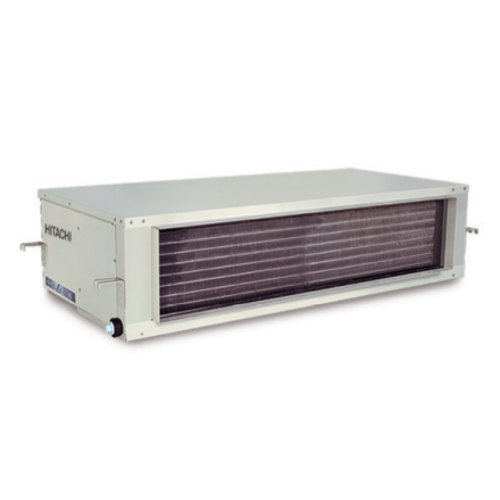

**Price:** `[PLACEHOLDER]` (price on request)

| Specification | Value |
|---|---|
| Model Number | 7.5 TR |
| Brand | Hitachi |
| Compressor Type | Rotary |
| Refrigerant | R22 |
| Rated Power Supply | 230 V,50 Hz (IDU / ODU) |
| Phase | 1 Phase |

**Features:**
- Wireless remote/wired remote
- Can work in temperature up to 52 deg C
- Kaimin mode
- Auto restart
- 5 modes of operation
- Filter clean indicator
- On/off timer with advanced startup

Source: https://www.indiamart.com/proddetail/hitachi-7-5-tr-r22-concealed-split-air-conditioner-20995261812.html

### 9.5 Ductable Air Conditioners (26)

> We are Hitachi's preferred channel partner and offer you complete solution with our Toushi and Takumi range of ductable air conditioners.

#### 9.5.1 Hitachi Toushi Series 5.5TR R410A Ductable Air Conditioner

**Images:** [hitachi-toushi-series-5-5tr-r410a-ductable-air-conditioner.jpg](images/products/ductable-air-conditioners/hitachi-toushi-series-5-5tr-r410a-ductable-air-conditioner.jpg)

**Price:** `[PLACEHOLDER]` (price on request)

| Specification | Value |
|---|---|
| Brand | Hitachi |
| Model Number | 5.5TR |
| Refrigerant | R410A |
| Compressor | Scroll |
| Rated Power Supply | 230V/50Hz (IDU),400V/50Hz (ODU) |
| Phase | 1 Phase (IDU),3 Phase (ODU) |

**Features:**
- High ambient design, works up to 52 deg C
- Lowest sound in its class
- Service friendly
- Phase starting of multiple compressor
- Stringent safety features
- Multiple compressors
- Wireless handset (optional)

Source: https://www.indiamart.com/proddetail/hitachi-toushi-series-5-5tr-r410a-ductable-air-conditioner-20994563973.html

#### 9.5.2 Hitachi Toushi Series 8.5TR R410A Single Circuit Ductable Air Conditioner

**Images:** [hitachi-toushi-series-8-5tr-r410a-single-circuit-ductable-air-conditioner.jpg](images/products/ductable-air-conditioners/hitachi-toushi-series-8-5tr-r410a-single-circuit-ductable-air-conditioner.jpg)

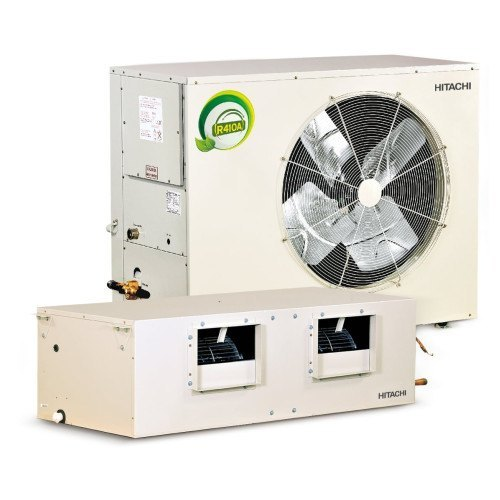

**Price:** `[PLACEHOLDER]` (price on request)

| Specification | Value |
|---|---|
| Brand | Hitachi |
| Model Number | 8.5TR |
| Refrigerant | R410A |
| Compressor | Scroll |
| Rated Power Supply | 230V/50Hz (IDU),400V/50Hz (ODU) |
| Phase | 1 Phase (IDU),3 Phase (ODU) |

**Features:**
- High ambient design, works up to 52 deg C
- Lowest sound in its class
- Service friendly
- Phase starting of multiple compressor
- Stringent safety features
- Multiple compressors
- Wireless handset (optional)

Source: https://www.indiamart.com/proddetail/hitachi-toushi-series-8-5tr-r410a-single-circuit-ductable-air-conditioner-20994592033.html

#### 9.5.3 Hitachi Toushi Series 8.5TR R410A Twin Circuit Ductable Air Conditioner

**Images:** [hitachi-toushi-series-8-5tr-r410a-twin-circuit-ductable-air-conditioner.jpg](images/products/ductable-air-conditioners/hitachi-toushi-series-8-5tr-r410a-twin-circuit-ductable-air-conditioner.jpg)

**Price:** `[PLACEHOLDER]` (price on request)

| Specification | Value |
|---|---|
| Brand | Hitachi |
| Model Number | 8.5TR |
| Refrigerant | R410A |
| Compressor | Scroll |
| Rated Power Supply | 230V/50Hz (IDU),400V/50Hz (ODU) |
| Phase | 1 Phase (IDU),3 Phase (ODU) |

**Features:**
- High ambient design, works up to 52 deg C
- Lowest sound in its class
- Service friendly
- Phase starting of multiple compressor
- Stringent safety features
- Multiple compressors
- Wireless handset (optional)

Source: https://www.indiamart.com/proddetail/hitachi-toushi-series-8-5tr-r410a-twin-circuit-ductable-air-conditioner-20994582688.html

#### 9.5.4 Hitachi Toushi Series 11.0TR R410A Single Circuit Ductable Air Conditioner

**Images:** [hitachi-toushi-series-11-0tr-r410a-single-circuit-ductable-air-conditioner.jpg](images/products/ductable-air-conditioners/hitachi-toushi-series-11-0tr-r410a-single-circuit-ductable-air-conditioner.jpg)

**Price:** `[PLACEHOLDER]` (price on request)

| Specification | Value |
|---|---|
| Brand | Hitachi |
| Model Number | 11.0TR |
| Refrigerant | R410A |
| Compressor | Scroll |
| Rated Power Supply | 230V/50Hz (IDU),400V/50Hz (ODU) |
| Phase | 1 Phase (IDU),3 Phase (ODU) |

**Features:**
- High ambient design, works up to 52 deg C
- Lowest sound in its class
- Service friendly
- Phase starting of multiple compressor
- Stringent safety features
- Multiple compressors
- Wireless handset (optional)

Source: https://www.indiamart.com/proddetail/hitachi-toushi-series-11-0tr-r410a-single-circuit-ductable-air-conditioner-20994585848.html

#### 9.5.5 Hitachi Toushi Series 11.0TR R410A Twin Circuit Ductable Air Conditioner

**Images:** [hitachi-toushi-series-11-0tr-r410a-twin-circuit-ductable-air-conditioner.jpg](images/products/ductable-air-conditioners/hitachi-toushi-series-11-0tr-r410a-twin-circuit-ductable-air-conditioner.jpg)

**Price:** `[PLACEHOLDER]` (price on request)

| Specification | Value |
|---|---|
| Brand | Hitachi |
| Model Number | 11.0TR |
| Refrigerant | R410A |
| Compressor | Scroll |
| Rated Power Supply | 230V/50Hz (IDU),400V/50Hz (ODU) |
| Phase | 1 Phase (IDU),3 Phase (ODU) |

**Features:**
- High ambient design, works up to 52 deg C
- Lowest sound in its class
- Service friendly
- Phase starting of multiple compressor
- Stringent safety features
- Multiple compressors
- Wireless handset (optional)

Source: https://www.indiamart.com/proddetail/hitachi-toushi-series-11-0tr-r410a-twin-circuit-ductable-air-conditioner-20994586933.html

#### 9.5.6 Hitachi Toushi Series 16.5TR R410A Ceiling Suspended Ductable Air Conditioner

**Images:** [hitachi-toushi-series-16-5tr-r410a-ceiling-suspended-ductable-air-conditioner.jpg](images/products/ductable-air-conditioners/hitachi-toushi-series-16-5tr-r410a-ceiling-suspended-ductable-air-conditioner.jpg)

**Price:** `[PLACEHOLDER]` (price on request)

| Specification | Value |
|---|---|
| Brand | Hitachi |
| Model Number | 16.5TR |
| Refrigerant | R410A |
| Compressor | Scroll |
| Rated Power Supply | 230V/50Hz (IDU),400V/50Hz (ODU) |
| Phase | 1 Phase (IDU),3 Phase (ODU) |

**Features:**
- High ambient design, works up to 52 deg C
- Lowest sound in its class
- Service friendly
- Phase starting of multiple compressor
- Stringent safety features
- Multiple compressors
- Wireless handset (optional)

Source: https://www.indiamart.com/proddetail/hitachi-toushi-series-16-5tr-r410a-ceiling-suspended-ductable-air-conditioner-20994593633.html

#### 9.5.7 Hitachi Toushi Series 16.5TR R410A Convertible Ductable Air Conditioner

**Images:** [hitachi-toushi-series-16-5tr-r410a-convertible-ductable-air-conditioner.jpg](images/products/ductable-air-conditioners/hitachi-toushi-series-16-5tr-r410a-convertible-ductable-air-conditioner.jpg)

**Price:** `[PLACEHOLDER]` (price on request)

| Specification | Value |
|---|---|
| Brand | Hitachi |
| Model Number | 16.5TR |
| Refrigerant | R410A |
| Compressor | Scroll |
| Rated Power Supply | 230V/50Hz (IDU),400V/50Hz (ODU) |
| Phase | 1 Phase (IDU),3 Phase (ODU) |

**Features:**
- High ambient design, works up to 52 deg C
- Lowest sound in its class
- Service friendly
- Phase starting of multiple compressor
- Stringent safety features
- Multiple compressors
- Wireless handset (optional)

Source: https://www.indiamart.com/proddetail/hitachi-toushi-series-16-5tr-r410a-convertible-ductable-air-conditioner-20994591433.html

#### 9.5.8 Hitachi Toushi Series 3 TR R22 Ductable Air Conditioner

**Images:** [hitachi-toushi-series-3-tr-r22-ductable-air-conditioner.jpg](images/products/ductable-air-conditioners/hitachi-toushi-series-3-tr-r22-ductable-air-conditioner.jpg)

**Price:** `[PLACEHOLDER]` (price on request)

| Specification | Value |
|---|---|
| Brand | Hitachi |
| Model Number | 3 TR |
| Refrigerant | R22 |
| Compressor | Twin Rotary |
| Phase | 1 Phase (IDU),3 Phase (ODU) |
| Rated Power Supply | 230V/50Hz (IDU),400V/50Hz (ODU) |

**Features:**
- High ambient design, works up to 52 deg C
- Lowest sound in its class
- Service friendly
- Phase starting of multiple compressor
- Stringent safety features
- Multiple compressors
- Wireless handset (optional)

Source: https://www.indiamart.com/proddetail/hitachi-toushi-series-3-tr-r22-ductable-air-conditioner-20994657691.html

#### 9.5.9 Hitachi Toushi Series 4 TR R22 Ductable Air Conditioner

**Images:** [hitachi-toushi-series-4-tr-r22-ductable-air-conditioner.jpg](images/products/ductable-air-conditioners/hitachi-toushi-series-4-tr-r22-ductable-air-conditioner.jpg)

**Price:** `[PLACEHOLDER]` (price on request)

| Specification | Value |
|---|---|
| Brand | Hitachi |
| Model Number | 4 TR |
| Refrigerant | R22 |
| Compressor | Rotary |
| Rated Power Supply | 230V/50Hz (IDU),400V/50Hz (ODU) |
| Phase | 1 Phase (IDU),3 Phase (ODU) |

**Features:**
- High ambient design, works up to 52 deg C
- Lowest sound in its class
- Service friendly
- Phase starting of multiple compressor
- Stringent safety features
- Multiple compressors
- Wireless handset (optional)

Source: https://www.indiamart.com/proddetail/hitachi-toushi-series-4-tr-r22-ductable-air-conditioner-20994669912.html

#### 9.5.10 Hitachi Toushi Series 5 TR R22 Ductable Air Conditioner

**Images:** [hitachi-toushi-series-5-tr-r22-ductable-air-conditioner.jpg](images/products/ductable-air-conditioners/hitachi-toushi-series-5-tr-r22-ductable-air-conditioner.jpg)

**Price:** `[PLACEHOLDER]` (price on request)

| Specification | Value |
|---|---|
| Brand | Hitachi |
| Model Number | 5 TR |
| Refrigerant | R22 |
| Compressor | Twin Rotary |
| Rated Power Supply | 230V/50Hz (IDU),400V/50Hz (ODU) |
| Phase | 1 Phase (IDU),3 Phase (ODU) |

**Features:**
- High ambient design, works up to 52 deg C
- Lowest sound in its class
- Service friendly
- Phase starting of multiple compressor
- Stringent safety features
- Multiple compressors
- Wireless handset (optional)

Source: https://www.indiamart.com/proddetail/hitachi-toushi-series-5-tr-r22-ductable-air-conditioner-20994672473.html

#### 9.5.11 Hitachi Toushi Series 5.5 TR R22 Ductable Air Conditioner

**Images:** [hitachi-toushi-series-5-5-tr-r22-ductable-air-conditioner.jpg](images/products/ductable-air-conditioners/hitachi-toushi-series-5-5-tr-r22-ductable-air-conditioner.jpg)

**Price:** `[PLACEHOLDER]` (price on request)

| Specification | Value |
|---|---|
| Brand | Hitachi |
| Model Number | 5.5 TR |
| Refrigerant | R22 |
| Compressor | Scroll |
| Rated Power Supply | 230V/50Hz (IDU),400V/50Hz (ODU) |
| Phase | 1 Phase (IDU),3 Phase (ODU) |

**Features:**
- High ambient design, works up to 52 deg C
- Lowest sound in its class
- Service friendly
- Phase starting of multiple compressor
- Stringent safety features
- Multiple compressors
- Wireless handset (optional)

Source: https://www.indiamart.com/proddetail/hitachi-toushi-series-5-5-tr-r22-ductable-air-conditioner-20994674933.html

#### 9.5.12 Hitachi Toushi Series 7.5 TR R22 Ductable Air Conditioner

**Images:** [hitachi-toushi-series-7-5-tr-r22-ductable-air-conditioner.jpg](images/products/ductable-air-conditioners/hitachi-toushi-series-7-5-tr-r22-ductable-air-conditioner.jpg)

**Price:** `[PLACEHOLDER]` (price on request)

| Specification | Value |
|---|---|
| Brand | Hitachi |
| Model Number | 7.5 TR |
| Refrigerant | R22 |
| Compressor | Twin Rotary |
| Rated Power Supply | 230V/50Hz (IDU),400V/50Hz (ODU) |
| Phase | 1 Phase (IDU),3 Phase (ODU) |

**Features:**
- High ambient design, works up to 52 deg C
- Lowest sound in its class
- Service friendly
- Phase starting of multiple compressor
- Stringent safety features
- Multiple compressors
- Wireless handset (optional)

Source: https://www.indiamart.com/proddetail/hitachi-toushi-series-7-5-tr-r22-ductable-air-conditioner-20994676412.html

#### 9.5.13 Hitachi Toushi Series 8.5 TR Single Circuit Ductable Air Conditioner

**Images:** [hitachi-toushi-series-8-5-tr-single-circuit-ductable-air-conditioner.jpg](images/products/ductable-air-conditioners/hitachi-toushi-series-8-5-tr-single-circuit-ductable-air-conditioner.jpg)

**Price:** `[PLACEHOLDER]` (price on request)

| Specification | Value |
|---|---|
| Brand | Hitachi |
| Model Number | 8.5 TR |
| Refrigerant | R22 |
| Compressor | Scroll |
| Rated Power Supply | 230V/50Hz (IDU),400V/50Hz (ODU) |
| Phase | 1 Phase (IDU),3 Phase (ODU) |

**Features:**
- High ambient design, works up to 52 deg C
- Lowest sound in its class
- Service friendly
- Phase starting of multiple compressor
- Stringent safety features
- Multiple compressors
- Wireless handset (optional)

Source: https://www.indiamart.com/proddetail/hitachi-toushi-series-8-5-tr-single-circuit-ductable-air-conditioner-20994683130.html

#### 9.5.14 Hitachi Toushi Series 8.5 TR Twin Circuit Ductable Air Conditioner

**Images:** [hitachi-toushi-series-8-5-tr-twin-circuit-ductable-air-conditioner.jpg](images/products/ductable-air-conditioners/hitachi-toushi-series-8-5-tr-twin-circuit-ductable-air-conditioner.jpg)

**Price:** `[PLACEHOLDER]` (price on request)

| Specification | Value |
|---|---|
| Brand | Hitachi |
| Model Number | 8.5 TR |
| Refrigerant | R22 |
| Compressor | Scroll |
| Rated Power Supply | 230V/50Hz (IDU),400V/50Hz (ODU) |
| Phase | 1 Phase (IDU),3 Phase (ODU) |

**Features:**
- High ambient design, works up to 52 deg C
- Lowest sound in its class
- Service friendly
- Phase starting of multiple compressor
- Stringent safety features
- Multiple compressors
- Wireless handset (optional)

Source: https://www.indiamart.com/proddetail/hitachi-toushi-series-8-5-tr-twin-circuit-ductable-air-conditioner-20994678673.html

#### 9.5.15 Hitachi Toushi Series 11.0 TR Single Circuit Ductable Air Conditioner

**Images:** [hitachi-toushi-series-11-0-tr-single-circuit-ductable-air-conditioner.jpg](images/products/ductable-air-conditioners/hitachi-toushi-series-11-0-tr-single-circuit-ductable-air-conditioner.jpg)

**Price:** `[PLACEHOLDER]` (price on request)

| Specification | Value |
|---|---|
| Brand | Hitachi |
| Model Number | 11.0 TR |
| Refrigerant | R22 |
| Compressor | Scroll |
| Rated Power Supply | 230V/50Hz (IDU),400V/50Hz (ODU) |
| Phase | 1 Phase (IDU),3 Phase (ODU) |

**Features:**
- High ambient design, works up to 52 deg C
- Lowest sound in its class
- Service friendly
- Phase starting of multiple compressor
- Stringent safety features
- Multiple compressors
- Wireless handset (optional)

Source: https://www.indiamart.com/proddetail/hitachi-toushi-series-11-0-tr-single-circuit-ductable-air-conditioner-20994681830.html

#### 9.5.16 Hitachi Toushi Series 11.0 TR Twin Circuit Ductable Air Conditioner

**Images:** [hitachi-toushi-series-11-0-tr-twin-circuit-ductable-air-conditioner.jpg](images/products/ductable-air-conditioners/hitachi-toushi-series-11-0-tr-twin-circuit-ductable-air-conditioner.jpg)

**Price:** `[PLACEHOLDER]` (price on request)

| Specification | Value |
|---|---|
| Brand | Hitachi |
| Model Number | 11.0 TR |
| Refrigerant | R22 |
| Compressor | Scroll |
| Rated Power Supply | 230V/50Hz (IDU),400V/50Hz (ODU) |
| Phase | 1 Phase (IDU),3 Phase (ODU) |

**Features:**
- High ambient design, works up to 52 deg C
- Lowest sound in its class
- Service friendly
- Phase starting of multiple compressor
- Stringent safety features
- Multiple compressors
- Wireless handset (optional)

Source: https://www.indiamart.com/proddetail/hitachi-toushi-series-11-0-tr-twin-circuit-ductable-air-conditioner-20994681712.html

#### 9.5.17 Hitachi Toushi Series 16.5 TR R22 Ceiling Ductable Air Conditioner

**Images:** [hitachi-toushi-series-16-5-tr-r22-ceiling-ductable-air-conditioner.jpg](images/products/ductable-air-conditioners/hitachi-toushi-series-16-5-tr-r22-ceiling-ductable-air-conditioner.jpg)

**Price:** `[PLACEHOLDER]` (price on request)

| Specification | Value |
|---|---|
| Brand | Hitachi |
| Model Number | 16.5 TR |
| Refrigerant | R22 |
| Compressor | Scroll |
| Rated Power Supply | 230V/50Hz (IDU),400V/50Hz (ODU) |
| Phase | 1 Phase (IDU),3 Phase (ODU) |

**Features:**
- High ambient design, works up to 52 deg C
- Lowest sound in its class
- Service friendly
- Phase starting of multiple compressor
- Stringent safety features
- Multiple compressors
- Wireless handset (optional)

Source: https://www.indiamart.com/proddetail/hitachi-toushi-series-16-5-tr-r22-ceiling-ductable-air-conditioner-20994681588.html

#### 9.5.18 Hitachi Toushi Series 16.5 TR Convertible Ductable Air Conditioner

**Images:** [hitachi-toushi-series-16-5-tr-convertible-ductable-air-conditioner.jpg](images/products/ductable-air-conditioners/hitachi-toushi-series-16-5-tr-convertible-ductable-air-conditioner.jpg)

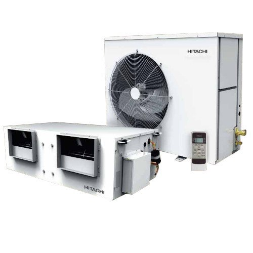

**Price:** `[PLACEHOLDER]` (price on request)

| Specification | Value |
|---|---|
| Brand | Hitachi |
| Model Number | 16.5 TR |
| Refrigerant | R410A |
| Compressor | Scroll |
| Rated Power Supply | 230V/50Hz (IDU),400V/50Hz (ODU) |
| Phase | 1 Phase (IDU),3 Phase (ODU) |

**Features:**
- High ambient design, works up to 52 deg C
- Lowest sound in its class
- Service friendly
- Phase starting of multiple compressor
- Stringent safety features
- Multiple compressors
- Wireless handset (optional)

Source: https://www.indiamart.com/proddetail/hitachi-toushi-series-16-5-tr-convertible-ductable-air-conditioner-20994680733.html

#### 9.5.19 Hitachi Takumi Series 5.5TR Ductable Air Conditioner

**Images:** [hitachi-takumi-series-5-5tr-ductable-air-conditioner.jpg](images/products/ductable-air-conditioners/hitachi-takumi-series-5-5tr-ductable-air-conditioner.jpg)

**Price:** `[PLACEHOLDER]` (price on request)

| Specification | Value |
|---|---|
| Brand | Hitachi |
| Model Number | 5.5 TR |
| Refrigerant | R410a |
| Compressor | Scroll |
| Rated Power Supply | 230 V / 50 Hz (IDU),400V / 50 Hz (ODU) |
| Phase | 1 Phase (IDU),3 Phase (ODU) |

**Features:**
- Variable speed condenser fan motor
- Phase starting of multiple units
- RS 485 cable communication
- Dripless drain pump (optional)
- UV lamp and ventilation (optional)
- Group control of multiple units (optional)

Source: https://www.indiamart.com/proddetail/hitachi-takumi-series-5-5tr-ductable-air-conditioner-20994808791.html

#### 9.5.20 Hitachi Takumi Series 8.5TR 2 Compressor Type Ductable Air Conditioner

**Images:** [hitachi-takumi-series-8-5tr-2-compressor-type-ductable-air-conditioner.jpg](images/products/ductable-air-conditioners/hitachi-takumi-series-8-5tr-2-compressor-type-ductable-air-conditioner.jpg)

**Price:** `[PLACEHOLDER]` (price on request)

| Specification | Value |
|---|---|
| Brand | Hitachi |
| Model Number | 8.5 TR |
| Refrigerant | R410A |
| Compressor | Scroll type |
| Rated Power Supply | 400V / 50 Hz (ODU)/ 230 V / 50 Hz (IDU) |
| Phase | 1 Phase (IDU),3 Phase (ODU) |

**Features:**
- High ambient design, works up to 52 deg C
- Lowest sound in its class
- Service friendly
- Phase starting of multiple compressor
- Stringent safety features
- Multiple compressors
- Wireless handset (optional)

Source: https://www.indiamart.com/proddetail/hitachi-takumi-series-8-5tr-2-compressor-type-ductable-air-conditioner-20994814891.html

#### 9.5.21 Hitachi Takumi Series 11TR 2 Compressor Type Ductable Air Conditioner

**Images:** [hitachi-takumi-series-11tr-2-compressor-type-ductable-air-conditioner.jpg](images/products/ductable-air-conditioners/hitachi-takumi-series-11tr-2-compressor-type-ductable-air-conditioner.jpg)

**Price:** `[PLACEHOLDER]` (price on request)

| Specification | Value |
|---|---|
| Brand | Hitachi |
| Model Number | 11 TR |
| Refrigerant | R410A |
| Compressor | Scroll |
| Rated Power Supply | 400V / 50 Hz (ODU)/ 230 V / 50 Hz (IDU) |
| Phase | 1 Phase (IDU),3 Phase (ODU) |

**Unique Characteristics**
**Powerful (More Efficient)**
- Part Load Operation
- Phase Starting of Compressor
- Phase Starting of Multiple Units
- Run Time Tracking & Equalisation of Compressors
**Proficient (Enhanced Performance)**
- Silent Operation
- Factory Charged Refrigerant
- Variable Speed Condenser Fan Moto
**Safety (Safer Units)**
- RS 485 Cable Connection
- Advanced Microprocessor Control
**Flexibility (Design Convenience)**
- Flexibility in IDU Mounting
- Compact Design
**Reliable (Higher Ambient Temperature)**
- Up to 52 deg C
**Comfort (Ease of Operation)**
- Central Station
- LCD Remote Control Handset
**UV Lamp with Ventilation**
**Drain Pump Assembly**
**Eco-friendly Refrigerant**
- R410a

Source: https://www.indiamart.com/proddetail/hitachi-takumi-series-11tr-2-compressor-type-ductable-air-conditioner-20994844091.html

#### 9.5.22 Hitachi Takumi Series 11TR Ductable Air Conditioner

**Images:** [hitachi-takumi-series-11tr-ductable-air-conditioner.jpg](images/products/ductable-air-conditioners/hitachi-takumi-series-11tr-ductable-air-conditioner.jpg)

**Price:** `[PLACEHOLDER]` (price on request)

| Specification | Value |
|---|---|
| Brand | Hitachi |
| Model Number | 11 TR |
| Refrigerant | R410A |
| Compressor | Scroll |
| Rated Power Supply | 400V / 50 Hz (ODU)/ 230 V / 50 Hz (IDU) |
| Phase | 1 Phase (IDU),3 Phase (ODU) |

**Features:**
- High ambient design, works up to 52 deg C
- Lowest sound in its class
- Service friendly
- Phase starting of multiple compressor
- Stringent safety features
- Multiple compressors
- Wireless handset (optional)

Source: https://www.indiamart.com/proddetail/hitachi-takumi-series-11tr-ductable-air-conditioner-20994825073.html

#### 9.5.23 Hitachi Takumi Series 8.5TR Ductable Air Conditioner

**Images:** [hitachi-takumi-series-8-5tr-ductable-air-conditioner.jpg](images/products/ductable-air-conditioners/hitachi-takumi-series-8-5tr-ductable-air-conditioner.jpg)

**Price:** `[PLACEHOLDER]` (price on request)

| Specification | Value |
|---|---|
| Brand | Hitachi |
| Model Number | 8.5TR |
| Refrigerant | R410A |
| Compressor | Scroll |
| Rated Power Supply | 400V / 50 Hz (ODU)/ 230 V / 50 Hz (IDU) |
| Phase | 1 Phase (IDU),3 Phase (ODU) |

**Features:**
- Variable speed condenser fan motor
- Phase starting of multiple units
- RS 485 cable communication
- Dripless drain pump (optional)
- UV lamp and ventilation (optional)
- Group control of multiple units (optional)

Source: https://www.indiamart.com/proddetail/hitachi-takumi-series-8-5tr-ductable-air-conditioner-20994830788.html

#### 9.5.24 Hitachi Takumi Series 16.5TR Convertible Ductable Air Conditioner

**Images:** [hitachi-takumi-series-16-5tr-convertible-ductable-air-conditioner.jpg](images/products/ductable-air-conditioners/hitachi-takumi-series-16-5tr-convertible-ductable-air-conditioner.jpg)

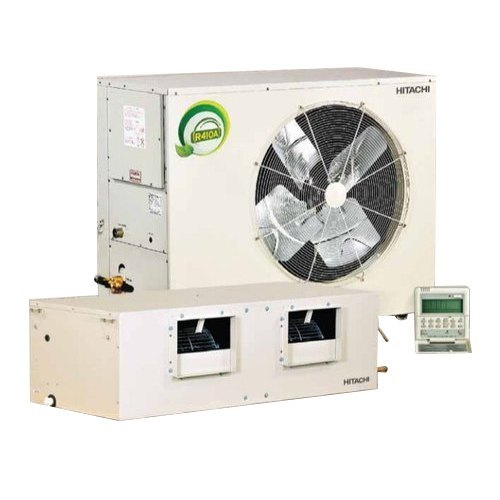

**Price:** `[PLACEHOLDER]` (price on request)

| Specification | Value |
|---|---|
| Brand | Hitachi |
| Model Number | 16.5 TR |
| Refrigerant | R410A |
| Compressor | Scroll type |
| Rated Power Supply | 400V / 50 Hz (ODU/IDU) |
| Phase | 3 Phase (ODU/IDU) |

Variable Speed Condenser Fan Motor
The microcontroller senses the ambient temperature with the help of Ambient Temperature Sensor and adjusts the fan speed accordingly, hence ensuring lower power consumption and efficient cooling.
Thus, in case of high ambient temperature, the fan speed increases, minimising the derating of compressor capacity without affecting the cooling capacity. In case of low ambient temperature, the fan speed is reduced to a lower level to suit your cooling requirement.
Benefits of Variable ODU Fan Speed
- Reduction of derating at higher ambient temperature
- Lower power consumption with higher capacity of the units, hence higher EER

Source: https://www.indiamart.com/proddetail/hitachi-takumi-series-16-5tr-convertible-ductable-air-conditioner-20994833462.html

#### 9.5.25 Hitachi Takumi Series 16.5TR Ceiling Ductable Air Conditioner

**Images:** [hitachi-takumi-series-16-5tr-ceiling-ductable-air-conditioner.jpg](images/products/ductable-air-conditioners/hitachi-takumi-series-16-5tr-ceiling-ductable-air-conditioner.jpg)

**Price:** `[PLACEHOLDER]` (price on request)

| Specification | Value |
|---|---|
| Brand | Hitachi |
| Model Number | 16.5TR |
| Refrigerant | R410A |
| Compressor | Scroll type |
| Rated Power Supply | 400V / 50 Hz (ODU)/ 230 V / 50 Hz (IDU) |
| Phase | 3 Phase (ODU/IDU) |

**Features:**
- High ambient design, works up to 52 deg C
- Lowest sound in its class
- Service friendly
- Phase starting of multiple compressor
- Stringent safety features
- Multiple compressors
- Wireless handset (optional)

Source: https://www.indiamart.com/proddetail/hitachi-takumi-series-16-5tr-ceiling-ductable-air-conditioner-20994835988.html

#### 9.5.26 Hitachi Air Conditioner

**Images:** `[PLACEHOLDER IMAGE]`

**Price:** `[PLACEHOLDER]` (price on request)

**Description:** `[PLACEHOLDER]` (no details given on IndiaMART)

### 9.6 VRF Systems (21)

> We are Hitachi's preferred channel partner and offer you a complete choice of outdoor units, indoor units and controllers that helps you in creating perfect air.

#### 9.6.1 Hitachi DXF 2.0A VRF AHU Kit

**Images:** [hitachi-dxf-2-0a-vrf-ahu-kit.jpg](images/products/vrf-systems/hitachi-dxf-2-0a-vrf-ahu-kit.jpg) · [hitachi-dxf-2-0a-vrf-ahu-kit-2.jpg](images/products/vrf-systems/hitachi-dxf-2-0a-vrf-ahu-kit-2.jpg)

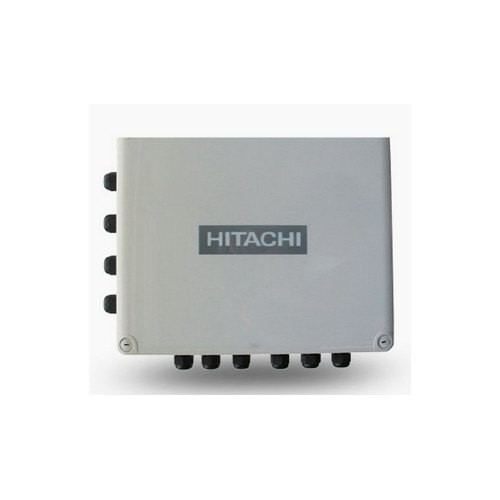

**Price:** `[PLACEHOLDER]` (price on request)

| Specification | Value |
|---|---|
| Brand | Hitachi |
| Model Number | DXF 2.0A |
| Nominal AHU Heat Exchanger Capacity | 2 HP |
| Nominal Heat Exchanger Cooling Capacity | 5 kW (4.0-5.6 kW) |
| Nominal Heat Exchanger heating Capacity | 5.6 kW (4.5-7.1 kW) |
| Power Source | 230V/ 50 Hz/ single phase |
| Control Box Dimension | 341x291x127 mm (HxWxD) |
| Expansion Box Dimension | 200x165x62 mm (HxWxD) |

**Features:**
- Available up to 20 HP capacity
- Other type of indoor unit can be connected in the same circuit
- Allowed air velocity up to 2.5 m/s cross filter section

Source: https://www.indiamart.com/proddetail/hitachi-dxf-2-0a-vrf-ahu-kit-20994418048.html

#### 9.6.2 Hitachi EZ PSC-A64GT Centralized AC Control Station

**Images:** [hitachi-ez-psc-a64gt-centralized-ac-control-station.jpg](images/products/vrf-systems/hitachi-ez-psc-a64gt-centralized-ac-control-station.jpg)

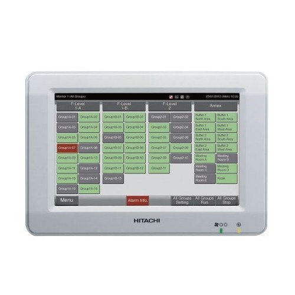

**Price:** `[PLACEHOLDER]` (price on request)

| Specification | Value |
|---|---|
| Brand | Hitachi |
| Model Number | EZ PSC-A64GT |
| Rated Power Supply | 100-240V,50/60 Hz,1 phase |
| Electrical Power Consumption | Max 30 W |
| Communication Line | Non polar 2 wire |
| Communication Speed | 9600 bps |
| Wiring Length | 1000 m (total length) |
| Display Control | Touch Panel |
| Building Scale | Small-medium |

**Features:**
- (8.5 inch) touch panel operation
- Alarm information
- Schedule up to 10 actions/day/RCS Group
- Available auto switch off timer

Source: https://www.indiamart.com/proddetail/hitachi-ez-psc-a64gt-centralized-ac-control-station-20994447530.html

#### 9.6.3 Hitachi PSC-AD128EX Centralized AC Control Station

**Images:** [hitachi-psc-ad128ex-centralized-ac-control-station.jpg](images/products/vrf-systems/hitachi-psc-ad128ex-centralized-ac-control-station.jpg)

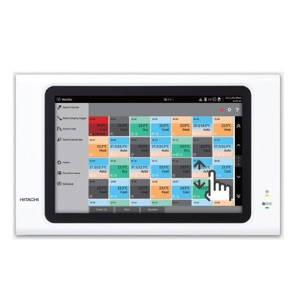

**Price:** `[PLACEHOLDER]` (price on request)

| Specification | Value |
|---|---|
| Brand | Hitachi |
| Model Number | PSC-AD128EX |
| Rated Power Supply | 100-240 VAC +/- 10% (50/60 Hz) |
| Electrical Power Consumption | Max 50 W |
| Communication Line | Non polar 2 wire |
| Communication Speed | 9600 bps |
| Wiring Length | 1000 m (total length) |
| Display | 12.1 inch TFT color liquid crystal display |
| Display Control | Touch panel |

**Features:**
- Touchscreen LCD panel for easy use
- Energy saving and quick management settings
- Schedule setting for long term category such as annual, summer and winter.
- Intuitive interface for better monitor

Source: https://www.indiamart.com/proddetail/hitachi-psc-ad128ex-centralized-ac-control-station-20994478673.html

#### 9.6.4 Hitachi RPK-1.0FSNK2 Wall Type Indoor VRF Unit

**Images:** [hitachi-rpk-1-0fsnk2-wall-type-indoor-vrf-unit.jpg](images/products/vrf-systems/hitachi-rpk-1-0fsnk2-wall-type-indoor-vrf-unit.jpg)

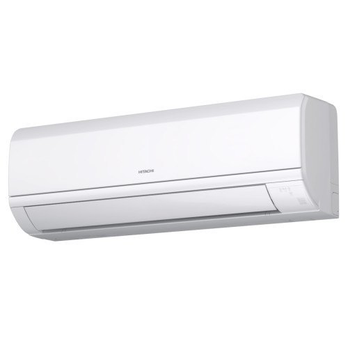

**Video:** https://www.youtube.com/watch?v=hngpuQiMiiY

**Price:** `[PLACEHOLDER]` (price on request)

| Specification | Value |
|---|---|
| Brand | Hitachi |
| Model | RPK-1.0FSNK2 |
| Frequency | 50 Hz |
| Phase | 1 |
| Voltage | 230 V |
| Cabinet Color | White |

**Features:**
- Wide range available from 1 to 4 HP
- Stylish flat looks
- iclean+: Auto filter cleansing Technology
- iSense: Motion sensor for optional comfort and power saving operations
- Stainless steel-coated filter for long life
- 4-way air swing: Uniform airflow and temperature in each corner of the room

Source: https://www.indiamart.com/proddetail/hitachi-rpk-1-0fsnk2-wall-type-indoor-vrf-unit-16820992333.html

#### 9.6.5 Hitachi Set Free Sigma RAS-8.0HNBCMQ1 8 HP VRF System

**Images:** [hitachi-set-free-sigma-ras-8-0hnbcmq1-8-hp-vrf-system.jpg](images/products/vrf-systems/hitachi-set-free-sigma-ras-8-0hnbcmq1-8-hp-vrf-system.jpg)

**Price:** `[PLACEHOLDER]` (price on request)

| Specification | Value |
|---|---|
| Brand | Hitachi |
| Refrigerant | R410A |
| Model | RAS-8.0HNBCMQ1 |
| Phase | 3 |
| Power Supply | 380-415/50 V/Hz |
| Compressor | Scroll |

**Extreme comfort**
- Smooth drive function
- Failure prevention
- Backup operation
**Enhanced efficiency**
- Best-in-class EER and part load
- Sigma shaped heat exchanger
- Air outlet design
- Compressor control
Engineered design flexibility
- Tropical ambient temperature (52 deg C) operation range
- External static pressure
- Piping connection
- Easier transportation
- Easier maintenance

Source: https://www.indiamart.com/proddetail/hitachi-set-free-sigma-ras-8-0hnbcmq1-8-hp-vrf-system-18808712648.html

#### 9.6.6 Hitachi Set Free Sigma RAS-10 HNBCMQ1 10 HP VRF System

**Images:** [hitachi-set-free-sigma-ras-10-hnbcmq1-10-hp-vrf-system.jpg](images/products/vrf-systems/hitachi-set-free-sigma-ras-10-hnbcmq1-10-hp-vrf-system.jpg)

**Price:** `[PLACEHOLDER]` (price on request)

| Specification | Value |
|---|---|
| Brand | Hitachi |
| Refrigerant | R410A |
| Model | RAS-10 HNBCMQ1 |
| Phase | 3 |
| Power Supply | 380-415/50 V/Hz |
| Compressor | Scroll |

**Extreme comfort**
- Smooth drive function
- Failure prevention
- Backup operation
**Enhanced efficiency**
- Best-in-class EER and part load
- Sigma shaped heat exchanger
- Air outlet design
- Compressor control
Engineered design flexibility
- Tropical ambient temperature (52 deg C) operation range
- External static pressure
- Piping connection
- Easier transportation
- Easier maintenance

Source: https://www.indiamart.com/proddetail/hitachi-set-free-sigma-ras-10-hnbcmq1-10-hp-vrf-system-19196376773.html

#### 9.6.7 Hitachi Set Free Sigma RAS-12 HNBCMQ1 12 HP VRF System

**Images:** [hitachi-set-free-sigma-ras-12-hnbcmq1-12-hp-vrf-system.jpg](images/products/vrf-systems/hitachi-set-free-sigma-ras-12-hnbcmq1-12-hp-vrf-system.jpg)

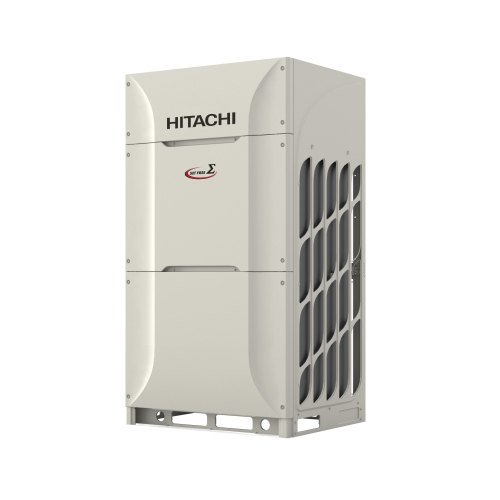

**Price:** `[PLACEHOLDER]` (price on request)

| Specification | Value |
|---|---|
| Brand | Hitachi |
| Refrigerant | R410A |
| Model | RAS-12HNBCMQ1 |
| Phase | 3 |
| Power Supply | 380-415/50 V/Hz |
| Compressor | Scroll |

**Extreme comfort**
- Smooth drive function
- Failure prevention
- Backup operation
**Enhanced efficiency**
- Best-in-class EER and part load
- Sigma shaped heat exchanger
- Air outlet design
- Compressor control
Engineered design flexibility
- Tropical ambient temperature (52 deg C) operation range
- External static pressure
- Piping connection
- Easier transportation
- Easier maintenance

Source: https://www.indiamart.com/proddetail/hitachi-set-free-sigma-ras-12-hnbcmq1-12-hp-vrf-system-19443095173.html

#### 9.6.8 Hitachi Set Free Sigma RAS-14HNBCMQ1 14 HP VRF System

**Images:** [hitachi-set-free-sigma-ras-14hnbcmq1-14-hp-vrf-system.jpg](images/products/vrf-systems/hitachi-set-free-sigma-ras-14hnbcmq1-14-hp-vrf-system.jpg)

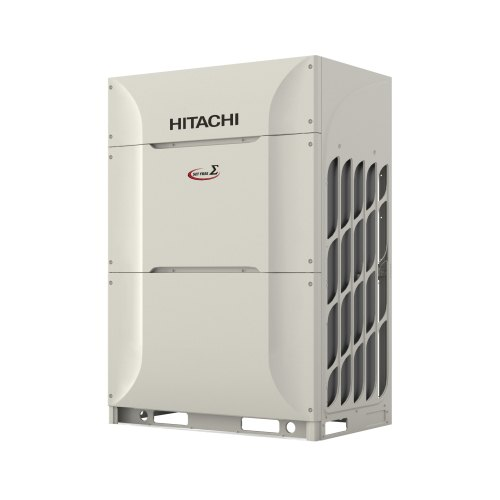

**Price:** `[PLACEHOLDER]` (price on request)

| Specification | Value |
|---|---|
| Brand | Hitachi |
| Refrigerant | R410A |
| Model | RAS-16HNBCMQ1 |
| Phase | 3 |
| Power Supply | 380-415/50 V/Hz |
| Compressor Type | Scroll |

**Extreme comfort**
- Smooth drive function
- Failure prevention
- Backup operation
**Enhanced efficiency**
- Best-in-class EER and part load
- Sigma shaped heat exchanger
- Air outlet design
- Compressor control
Engineered design flexibility
- Tropical ambient temperature (52 deg C) operation range
- External static pressure
- Piping connection
- Easier transportation
- Easier maintenance

Source: https://www.indiamart.com/proddetail/hitachi-set-free-sigma-ras-14hnbcmq1-14-hp-vrf-system-19196378512.html

#### 9.6.9 Hitachi Set Free Sigma RAS-16HNBCMQ1 16 HP VRF System

**Images:** [hitachi-set-free-sigma-ras-16hnbcmq1-16-hp-vrf-system.jpg](images/products/vrf-systems/hitachi-set-free-sigma-ras-16hnbcmq1-16-hp-vrf-system.jpg)

**Price:** `[PLACEHOLDER]` (price on request)

| Specification | Value |
|---|---|
| Brand | Hitachi |
| Refrigerant | R410A |
| Model | RAS-16HNBCMQ1 |
| Phase | 3 |
| Power Supply | 380-415/50 V/Hz |
| Compressor Type | Scroll |

**Extreme comfort**
- Smooth drive function
- Failure prevention
- Backup operation
**Enhanced efficiency**
- Best-in-class EER and part load
- Sigma shaped heat exchanger
- Air outlet design
- Compressor control
Engineered design flexibility
- Tropical ambient temperature (52 deg C) operation range
- External static pressure
- Piping connection
- Easier transportation
- Easier maintenance

Source: https://www.indiamart.com/proddetail/hitachi-set-free-sigma-ras-16hnbcmq1-16-hp-vrf-system-19196374933.html

#### 9.6.10 Hitachi Set Free Sigma RAS-18HNBCMQ1 18 HP VRF System

**Images:** [hitachi-set-free-sigma-ras-18hnbcmq1-18-hp-vrf-system.jpg](images/products/vrf-systems/hitachi-set-free-sigma-ras-18hnbcmq1-18-hp-vrf-system.jpg)

**Price:** `[PLACEHOLDER]` (price on request)

| Specification | Value |
|---|---|
| Brand | Hitachi |
| Refrigerant | R410A |
| Model | RAS-18HNBCMQ1 |
| Phase | 3 |
| Power Supply | 380-415/50 V/Hz |
| Compressor Type | Scroll |

**Extreme comfort**
- Smooth drive function
- Failure prevention
- Backup operation
**Enhanced efficiency**
- Best-in-class EER and part load
- Sigma shaped heat exchanger
- Air outlet design
- Compressor control
Engineered design flexibility
- Tropical ambient temperature (52 deg C) operation range
- External static pressure
- Piping connection
- Easier transportation
- Easier maintenance

Source: https://www.indiamart.com/proddetail/hitachi-set-free-sigma-ras-18hnbcmq1-18-hp-vrf-system-19196375648.html

#### 9.6.11 Hitachi Set Free Sigma RAS-20HNBCMQ1 20 HP VRF System

**Images:** [hitachi-set-free-sigma-ras-20hnbcmq1-20-hp-vrf-system.jpg](images/products/vrf-systems/hitachi-set-free-sigma-ras-20hnbcmq1-20-hp-vrf-system.jpg)

**Price:** `[PLACEHOLDER]` (price on request)

| Specification | Value |
|---|---|
| Brand | Hitachi |
| Refrigerant | R410A |
| Model | RAS-20HNBCMQ1 |
| Phase | 3 |
| Power Supply | 380-415/50 V/Hz |
| Compressor Type | Scroll |

The all new SET FREE Sigma Series of VRF systems is tailor-made to suit the customer requirements of higher efficiency, engineered aesthetics, enhanced strength, comfort design and more.
All new DC Inverter Scroll Compressor
Extreme comfort
- Smooth drive function
- Failure prevention
- Backup operation
**Enhanced efficiency**
- Best-in-class EER and part load
- Sigma shaped heat exchanger
- Air outlet design
- Compressor control
Engineered design flexibility
- Tropical ambient temperature (52 deg C) operation range
- External static pressure
- Piping connection
- Easier transportation
- Easier maintenance

Source: https://www.indiamart.com/proddetail/hitachi-set-free-sigma-ras-20hnbcmq1-20-hp-vrf-system-18734791330.html

#### 9.6.12 Hitachi Set Free Sigma RAS-22HNBCMQ1 22 HP VRF System

**Images:** [hitachi-set-free-sigma-ras-22hnbcmq1-22-hp-vrf-system.jpg](images/products/vrf-systems/hitachi-set-free-sigma-ras-22hnbcmq1-22-hp-vrf-system.jpg)

**Price:** `[PLACEHOLDER]` (price on request)

| Specification | Value |
|---|---|
| Brand | Hitachi |
| Refrigerant | R410A |
| Model | RAS-22HNBCMQ1 |
| Phase | 3 |
| Power Supply | 380-415/50 V/Hz |
| Compressor Type | Scroll |

**Extreme comfort**
- Smooth drive function
- Failure prevention
- Backup operation
**Enhanced efficiency**
- Best-in-class EER and part load
- Sigma shaped heat exchanger
- Air outlet design
- Compressor control
Engineered design flexibility
- Tropical ambient temperature (52 deg C) operation range
- External static pressure
- Piping connection
- Easier transportation
- Easier maintenance

Source: https://www.indiamart.com/proddetail/hitachi-set-free-sigma-ras-22hnbcmq1-22-hp-vrf-system-16820994948.html

#### 9.6.13 Hitachi Set Free Sigma RAS-24HNBCMQ1 24 HP VRF System

**Images:** [hitachi-set-free-sigma-ras-24hnbcmq1-24-hp-vrf-system.jpg](images/products/vrf-systems/hitachi-set-free-sigma-ras-24hnbcmq1-24-hp-vrf-system.jpg)

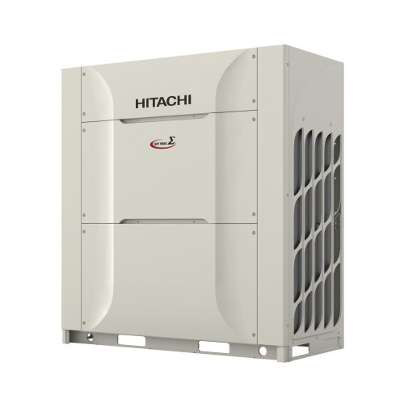

**Price:** `[PLACEHOLDER]` (price on request)

| Specification | Value |
|---|---|
| Brand | Hitachi |
| Refrigerant | R410A |
| Model | RAS-24HNBCMQ1 |
| Phase | 3 |
| Power Supply | 380-415/50 V/Hz |
| Compressor Type | Scroll |

**Extreme comfort**
- Smooth drive function
- Failure prevention
- Backup operation
**Enhanced efficiency**
- Best-in-class EER and part load
- Sigma shaped heat exchanger
- Air outlet design
- Compressor control
Engineered design flexibility
- Tropical ambient temperature (52 deg C) operation range
- External static pressure
- Piping connection
- Easier transportation
- Easier maintenance

Source: https://www.indiamart.com/proddetail/hitachi-set-free-sigma-ras-24hnbcmq1-24-hp-vrf-system-16820995412.html

#### 9.6.14 Hitachi RPIZ-1.0FSN1Q Low Height Indoor VRF Unit

**Images:** [hitachi-rpiz-1-0fsn1q-low-height-indoor-vrf-unit.jpg](images/products/vrf-systems/hitachi-rpiz-1-0fsn1q-low-height-indoor-vrf-unit.jpg)

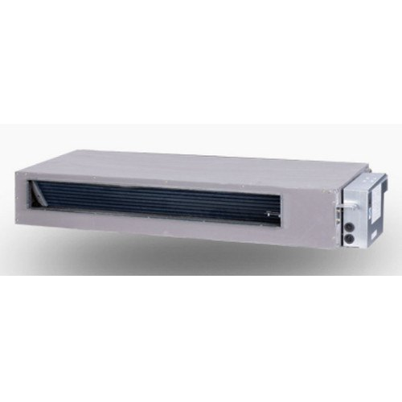

**Price:** `[PLACEHOLDER]` (price on request)

| Specification | Value |
|---|---|
| Brand | Hitachi |
| Refrigerant | R410A |
| Model | RPIZ-1.0FSN1Q |
| Operating Voltage | 230 V |
| Connection | Flare nut connection (with flare nuts) |
| Phase | 1 phase |
| Frequency | 50 Hz |

**Features:**
- Designed for high sensible load for Indian weather conditions with higher CFM (400 CFM/Tr)
- Suitable for low height ceiling with only 192 mm height indoor units
- Inbuilt drain pump for water lift upto 900 mm
- Range available from 1 to 2.5 HP

Source: https://www.indiamart.com/proddetail/hitachi-rpiz-1-0fsn1q-low-height-indoor-vrf-unit-16820994288.html

#### 9.6.15 Hitachi RPI1.0FSNK1 High Air Quantity Ceiling Type Indoor VRF Unit

**Images:** [hitachi-rpi1-0fsnk1-high-air-quantity-ceiling-type-indoor-vrf-unit.jpg](images/products/vrf-systems/hitachi-rpi1-0fsnk1-high-air-quantity-ceiling-type-indoor-vrf-unit.jpg)

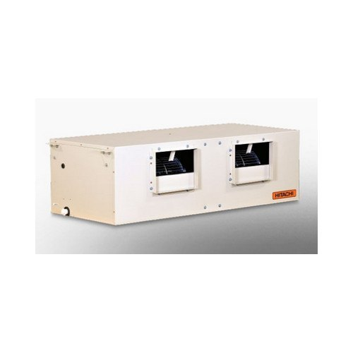

**Price:** `[PLACEHOLDER]` (price on request)

| Specification | Value |
|---|---|
| Brand | Hitachi |
| Model Number | RPI1.0FSNK1 |
| Frequency | 50 Hz |
| Phase | 1 phase |
| Voltage Range | 230 V |
| Cabinet Color | Natural Gray |
| Refrigerant | R410A |

**Features:**
- Designed for high sensible load for Indian weather conditions with higher CFM (400 CFM/Tr)
- Suitable for low height ceiling with only 192 mm height indoor units
- Inbuilt drain pump for water lift upto 900 mm
- Range available from 1 to 10 HP
Available with LHS and RHS provisions specially designed to have mirror installation in nearly rooms such as hotels, etc.

Source: https://www.indiamart.com/proddetail/hitachi-rpi1-0fsnk1-high-air-quantity-ceiling-type-indoor-vrf-unit-16820993155.html

#### 9.6.16 Hitachi RCS-0.8FSN 1 Way Cassette Type Indoor VRF Unit

**Images:** [hitachi-rcs-0-8fsn-1-way-cassette-type-indoor-vrf-unit.jpg](images/products/vrf-systems/hitachi-rcs-0-8fsn-1-way-cassette-type-indoor-vrf-unit.jpg)

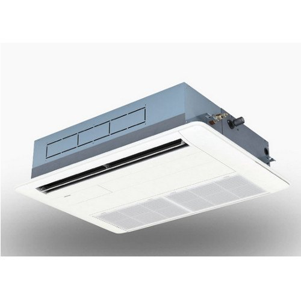

**Price:** `[PLACEHOLDER]` (price on request)

| Specification | Value |
|---|---|
| Brand | Hitachi |
| Model Number | RCS-0.8FSN |
| Frequency | 50/60 Hz |
| Voltage | 220-240 V |
| Phase | 1 phase |
| Refrigerant | R410A |

**Features:**
- Quiet operation with low sound level of 27 dB (A)
- Motion sensor technology (optional)
- Suitable for high ceiling space up to 5.3 m
- Standard drain pump with 850 mm lift available
- Flexible installation with 3 type airflow option
- Range available from 0.8 to 3 HP

Source: https://www.indiamart.com/proddetail/hitachi-rcs-0-8fsn-1-way-cassette-type-indoor-vrf-unit-18808712588.html

#### 9.6.17 Hitachi RCD-0.8FSN3 2 Way Cassette Type Indoor VRF Unit

**Images:** [hitachi-rcd-0-8fsn3-2-way-cassette-type-indoor-vrf-unit.jpg](images/products/vrf-systems/hitachi-rcd-0-8fsn3-2-way-cassette-type-indoor-vrf-unit.jpg)

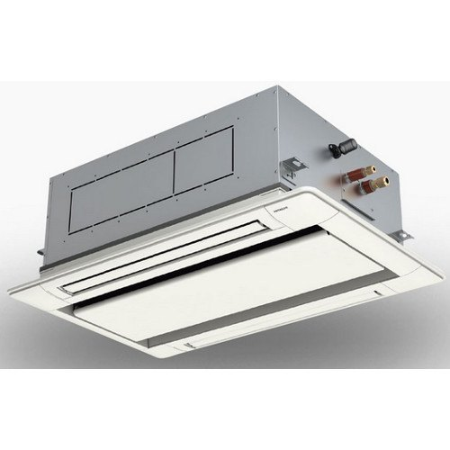

**Price:** `[PLACEHOLDER]` (price on request)

| Specification | Value |
|---|---|
| Brand | Hitachi |
| Model Number | RCD-0.8FSN3 |
| Indoor Unit Power Supply | 220-240V/560 Hz,220V/60 Hz |
| Refrigerant | R410A (Nitrogen-charged for corrosion resistance) |
| Phase | 1 phase |
| Connections | Flare-Nut Connection |

**Features:**
- Wide range available from 0.8 to 6 HP.
- Controlled air flow with individual Louvre
- Motion sensor technology (optional)
- Suitable for high ceiling space up to 4.6 m
- Standard drain pump with 850 mm lift available
- Easy fine tune for the installment height

Source: https://www.indiamart.com/proddetail/hitachi-rcd-0-8fsn3-2-way-cassette-type-indoor-vrf-unit-18808712233.html

#### 9.6.18 Hitachi RCI-1.0FSKDNQ 4 Way Cassette Type Indoor VRF Unit

**Images:** [hitachi-rci-1-0fskdnq-4-way-cassette-type-indoor-vrf-unit.jpg](images/products/vrf-systems/hitachi-rci-1-0fskdnq-4-way-cassette-type-indoor-vrf-unit.jpg)

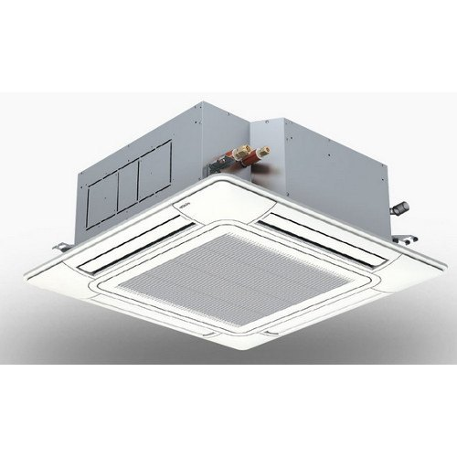

**Price:** `[PLACEHOLDER]` (price on request)

| Specification | Value |
|---|---|
| Brand | Hitachi |
| Model Number | RCI-1.0FSKDNQ |
| Refrigerant Type | R410a |
| Indoor Unit Power Supply | 220-240V/560 Hz,220V/60 Hz |
| Phase | 1 phase |
| Connections | Flare-Nut Connection |

**Features:**
- Wide range available from 1 to 6 HP
- Motion sensor technology (optional)
- Suitable for high ceiling space upto 4.6 m
- Easy fine tune for the installment height
- Controlled airflow with individual louvres

Source: https://www.indiamart.com/proddetail/hitachi-rci-1-0fskdnq-4-way-cassette-type-indoor-vrf-unit-18808712391.html

#### 9.6.19 Hitachi RCIM-1.0FSN4 4 Way Cassette Compact Type Indoor VRF Unit

**Images:** [hitachi-rcim-1-0fsn4-4-way-cassette-compact-type-indoor-vrf-unit.jpg](images/products/vrf-systems/hitachi-rcim-1-0fsn4-4-way-cassette-compact-type-indoor-vrf-unit.jpg)

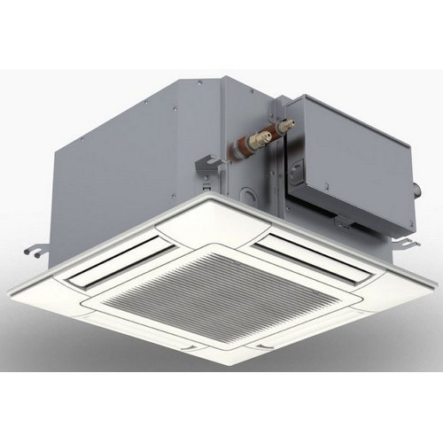

**Price:** `[PLACEHOLDER]` (price on request)

| Specification | Value |
|---|---|
| Brand | Hitachi |
| Model Number | RCIM-1.0FSN4 |
| Outdoor Noise Level | Upto 24.5 dB(A) |
| Size/Dimension | 600 x 600 mm (air panel) |
| Refrigerant Type | R410A |
| Phase | 1 phase |
| Indoor Unit Power Supply | 230V/50 Hz,220-240V/50 Hz,220V/60 Hz |

**Features:**
- Extremely quiet operation
- Compact size of air panel
- Easier height adjustment
- Suitable for high ceiling space upto 4.6 m
- New antibactreial drain pan
- Fresh air absorption unit (optional part)
- Range available from 1 to 3.5 HP

Source: https://www.indiamart.com/proddetail/hitachi-rcim-1-0fsn4-4-way-cassette-compact-type-indoor-vrf-unit-20994405862.html

#### 9.6.20 Hitachi PC-ARF1 Advanced Wired Remote Controller

**Images:** [hitachi-pc-arf1-advanced-wired-remote-controller.jpg](images/products/vrf-systems/hitachi-pc-arf1-advanced-wired-remote-controller.jpg)

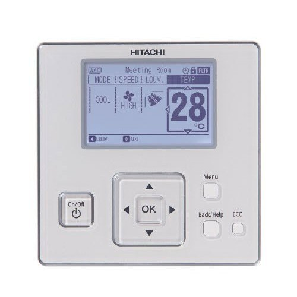

**Price:** `[PLACEHOLDER]` (price on request)

| Specification | Value |
|---|---|
| Brand | Hitachi |
| Color | Pearl White |
| Model Number | PC-ARF1 |
| Dimensions | 120x120x17.9 mm (HxWxD) |
| Net Weight | 200 g Settable |
| Timer Operation | 5 times per day |

**Features:**
- ODU noise schedule setting
- ODU capacity control
- Indoor unit rotation control
- Automatic fan operation

Source: https://www.indiamart.com/proddetail/hitachi-pc-arf1-advanced-wired-remote-controller-20994433212.html

#### 9.6.21 Hitachi HCWA10NEGQ Advanced Wired Remote Controller

**Images:** [hitachi-hcwa10negq-advanced-wired-remote-controller.jpg](images/products/vrf-systems/hitachi-hcwa10negq-advanced-wired-remote-controller.jpg)

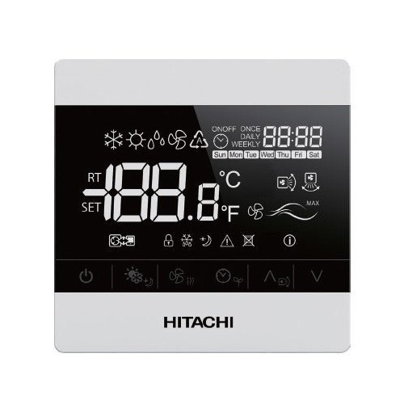

**Price:** `[PLACEHOLDER]` (price on request)

| Specification | Value |
|---|---|
| Brand | Hitachi |
| Model Number | HCWA10NEGQ |
| Outer Dimensions | 88x88x15.5 mm (HxWxD) mm |
| Display Screen | LCD |
| Mode Setting | 5 |

We are offering **Hitachi HCWA10NEGQ Advanced Wired Remote Controller** to our clients.
**Features:**
- 5 mode setting
- Timer setting

Source: https://www.indiamart.com/proddetail/hitachi-hcwa10negq-advanced-wired-remote-controller-20994502162.html

### 9.7 Hitachi Chillers (3)

> We are Hitachi's preferred channel partner and offer you a complete range of chillers in water cooled screw, air cooled screw and centrifugal series.

#### 9.7.1 Hitachi Air Cooled Screw Chillers

**Images:** [hitachi-air-cooled-screw-chillers.jpg](images/products/hitachi-chillers/hitachi-air-cooled-screw-chillers.jpg)

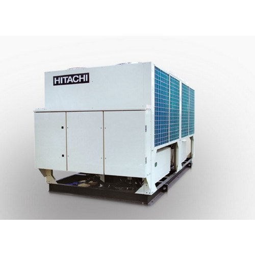

**Price:** `[PLACEHOLDER]` (price on request)

| Specification | Value |
|---|---|
| Brand | Hitachi |
| Refrigerant | R134a |
| Capacity | 45 to 450 Tr.f |
| Type | Semi-Hermetic Twin-Screw compressor |

Incorporating proprietary cutting edge technology, Hitachi's air cooled chiller combines high efficiency performance and stable operation. Our New compressor uses environment friendly refrigerant. Hitachi's unique features low noise, low vibration, high efficiency and high performance comes with a user-friendly touch panel type liquid crystal screen at a glance and has a full range of control functions. Hitachi's new air cooled chiller is perfect answer to all your needs, designed to cover all applications ranging from air conditioning of buildings to process application of factories.
**Features: **
- Advanced control panel
- Extremely low noise and vibration
- Factory fitted excellent protection controls
- Precise continuous capacity control technology (25% to 100%)
- Highly efficient Hitachi screw compressor

Source: https://www.indiamart.com/proddetail/hitachi-air-cooled-screw-chillers-20995803348.html

#### 9.7.2 Hitachi Water Cooled Screw Chillers

**Images:** [hitachi-water-cooled-screw-chillers.jpg](images/products/hitachi-chillers/hitachi-water-cooled-screw-chillers.jpg)

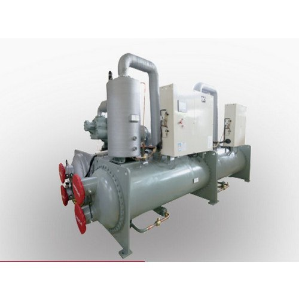

**Price:** `[PLACEHOLDER]` (price on request)

| Specification | Value |
|---|---|
| Capacity | 25 to 100% |
| Brand | Hitachi |
| Type | Semi-Hermetic Twin-Screw compressor |
| Refrigerant | R134a |

Incorporating proprietary cutting edge technology, Hitachi's air cooled chiller combines high efficiency performance and stable operation. Our New compressor uses environment friendly refrigerant. Hitachi's unique features low noise, low vibration, high efficiency and high performance comes with a user-friendly touch panel type liquid crystal screen at a glance and has a full range of control functions. Hitachi's new air cooled chiller is perfect answer to all your needs, designed to cover all applications ranging from air conditioning of buildings to process application of factories.
**Features: **
- Advanced control panel
- Extremely low noise and vibration
- Factory fitted excellent protection controls
- Precise continuous capacity control technology (25% to 100%)
- Highly efficient Hitachi screw compressor

Source: https://www.indiamart.com/proddetail/hitachi-water-cooled-screw-chillers-20995802973.html

#### 9.7.3 Hitachi Direct Drive Centrifugal Chiller

**Images:** [hitachi-direct-drive-centrifugal-chiller.jpg](images/products/hitachi-chillers/hitachi-direct-drive-centrifugal-chiller.jpg)

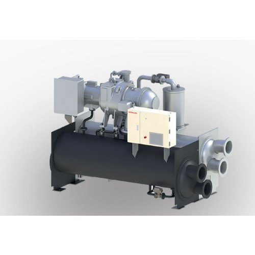

**Price:** `[PLACEHOLDER]` (price on request)

| Specification | Value |
|---|---|
| Brand | Hitachi |
| Capacity | 300 to 1100 Tr |
| Refrigerant | R134a |
| Auto Restart | Within 10 sec after power failure |
| Display Size | 10.4 inch |
| Display Type | Touch LCD |

Incorporating proprietary cutting edge technology, Hitachi's air cooled chiller combines high efficiency performance and stable operation. Our New compressor uses environment friendly refrigerant. Hitachi's unique features low noise, low vibration, high efficiency and high performance comes with a user-friendly touch panel type liquid crystal screen at a glance and has a full range of control functions. Hitachi's new air cooled chiller is perfect answer to all your needs, designed to cover all applications ranging from air conditioning of buildings to process application of factories.
**Features: **
- Advanced control panel
- Extremely low noise and vibration
- Factory fitted excellent protection controls
- Precise continuous capacity control technology (25% to 100%)
- Highly efficient Hitachi screw compressor

Source: https://www.indiamart.com/proddetail/hitachi-direct-drive-centrifugal-chiller-20995807873.html

### 9.8 AC (Other) (4)

> Pioneers in the industry, we offer Bajaj Finserv AC, AC Repair Services, Hitachi Window AC and Portable Air Conditioners.

#### 9.8.1 Bajaj Finserv AC

**Images:** `[PLACEHOLDER IMAGE]`

**Price:** `[PLACEHOLDER]` (price on request)

**Description:** `[PLACEHOLDER]` (no details given on IndiaMART)

#### 9.8.2 Ac Repair Services

**Images:** `[PLACEHOLDER IMAGE]`

**Price:** `[PLACEHOLDER]` (price on request)

**Description:** `[PLACEHOLDER]` (no details given on IndiaMART)

#### 9.8.3 Hitachi Window Ac

**Images:** `[PLACEHOLDER IMAGE]`

**Price:** `[PLACEHOLDER]` (price on request)

**Description:** `[PLACEHOLDER]` (no details given on IndiaMART)

#### 9.8.4 Portable Air Conditioners

**Images:** `[PLACEHOLDER IMAGE]`

**Price:** `[PLACEHOLDER]` (price on request)

**Description:** `[PLACEHOLDER]` (no details given on IndiaMART)

### 9.9 AC Installation Service (1)

> We are a leading Wholesale Distributor of AC Installation Service from Jodhpur, India.

#### 9.9.1 Ac Installation Service

**Images:** `[PLACEHOLDER IMAGE]`

**Price:** `[PLACEHOLDER]` (price on request)

**Description:** `[PLACEHOLDER]` (no details given on IndiaMART)

### 9.10 AC Maintenance Service (1)

> Our range of products include AC Maintenance Services.

#### 9.10.1 Ac Maintenance Services

**Images:** `[PLACEHOLDER IMAGE]`

**Price:** `[PLACEHOLDER]` (price on request)

**Description:** `[PLACEHOLDER]` (no details given on IndiaMART)
